# 3. 条形图

条形图是最常用的数据可视化方法之一：x 轴为类别，y 轴为数值。条形图适合比较不同类别的数值，但不适合展示数值随时间的变化趋势（时间是连续变量）。

从本章开始，重点介绍使用 ggplot2。ggplot2 不仅更简单，还能绘制出更复杂、精美的图形。

## 3.1 基础条形图

### 3.1.1 问题

绘制条形图：你有一个数据框，其中一列表示 bar 在 x 轴上的位置，另一列表示每个 bar 的垂直高度（y 轴）。

### 3.1.2 解决方案

`ggplot()` 结合 `geom_col()`，指定 x 和 y 变量（图 3.1）：

```R
library(gcookbook) # gcookbook 提供 pg_mean 数据集
library(ggplot2)

ggplot(pg_mean, aes(x = group, y = weight)) +
  geom_col()
```


>  **图 3.1**：具有离散 x 轴的数值条形图

### 3.1.3 讨论

当 x 为连续（数值）变量时，条形图表现不同：此时，条形不只出现在实际 x 值处，而是在最小值和最大值之间的每个可能 x 值处都预留位置（图 3.2）。可以使用 `factor()` 将连续变量转换为离散变量。

- BOD 数据集中没有 `Time == 6` 的记录

```R
> BOD
  Time demand
1    1    8.3
2    2   10.3
3    3   19.0
4    4   16.0
5    5   15.6
6    7   19.8
```

- `Time` 是数值型（连续）变量

```R
> str(BOD)
'data.frame':	6 obs. of  2 variables:
 $ Time  : num  1 2 3 4 5 7
 $ demand: num  8.3 10.3 19 16 15.6 19.8
 - attr(*, "reference")= chr "A1.4, p. 270"
```

- 绘制条形图

```R
library(gcookbook)
library(ggplot2)

ggplot(BOD, aes(x = Time, y = demand)) +
  geom_col()
```

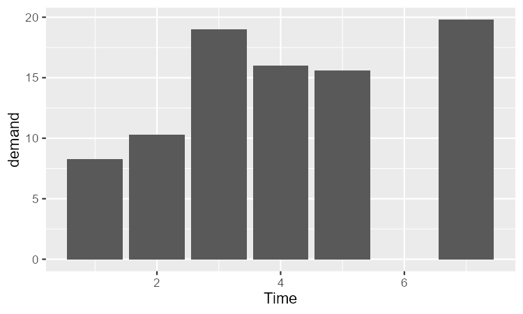

> **图 3.2**：具有连续 x 轴的数值条形图

- 使用 `factor()` 将 `Time` 转换为离散（分类）变量

```R
library(gcookbook)
library(ggplot2)

ggplot(BOD, aes(x = factor(Time), y = demand)) +
  geom_col()
```

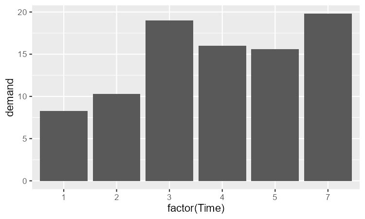

> **图 3.2**：将变量 x 转换为 factor 后的条形图

注意，`BOD` 数据集中没有 `Time = 6`：

- 当 x 为连续变量时，`ggplot2` 使用数值坐标轴，该坐标轴会为范围内所有数值预留空间，因此在 6 处留空位；
- 将 `Time` 转换为 `factor` 后，`ggplot2` 将其视为离散变量，这些值被当作标签而非数值处理，因此不会为最小值和最大值之间所有数值分配空间。

> [!TIP]
>
> 上例中，数据已包含 x 值和 y  两列。如果希望条形高度代表各组案例的计数（频数），见 3.3 节。

条形图默认使用深灰色填充：用 `fill` 参数设置填充色，用 `colour` 参数设置边框色。图 3.3 使用浅蓝色填充和黑色边框：

```r
library(gcookbook)
library(ggplot2)

ggplot(pg_mean, aes(x = group, y = weight)) +
  geom_col(fill = "lightblue", colour = "black")
```

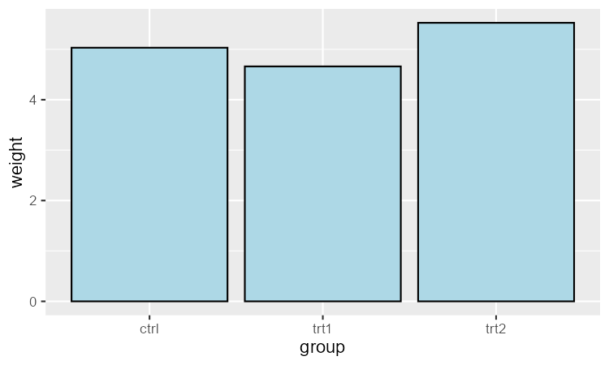

>  **图 3.3**：所有条形使用统一填充色和边框色

> [!NOTE]
>
> `ggplot2` 默认使用英式拼写 `colour`，不过美式拼写 `color` 在内部会自动映射为英式拼写，同样有效。

### 3.1.4 另请参阅

- 条形高度代表计数（频数）：见 3.3 节。
- 根据另一个变量的值重排因子（factor）级别：见 15.9 节；手动更改因子级别顺序：见 15.8 节。
- 颜色更多信息：见第 12 章。

## 3.2 条形分组

### 3.2.1 问题

希望根据第二个变量将条形进行分组。

### 3.2.2 解决方案

将一个变量映射到填充色（`fill`），并使用 `geom_col(position = "dodge")`。（`dodge` 表示并列错开显示）。

示例：使用 `cabbage_exp` 数据集，该数据集包含两个分类变量（`Cultivar` 和 `Date`）和一个连续变量（`Weight`）：

- 加载 `gcookbook` 包，获取 `cabbage_exp` 数据集

```R
> library(gcookbook)
> cabbage_exp
  Cultivar Date Weight        sd  n         se
1      c39  d16   3.18 0.9566144 10 0.30250803
2      c39  d20   2.80 0.2788867 10 0.08819171
3      c39  d21   2.74 0.9834181 10 0.31098410
4      c52  d16   2.26 0.4452215 10 0.14079141
5      c52  d20   3.11 0.7908505 10 0.25008887
6      c52  d21   1.47 0.2110819 10 0.06674995
```

- 将 `Date` 映射到 x 轴，将 `Cultivar` 映射到填充色（图 3.4）

```r
library(gcookbook)
library(ggplot2)

ggplot(cabbage_exp, aes(x = Date, y = Weight, fill = Cultivar)) +
  geom_col(position = "dodge")
```

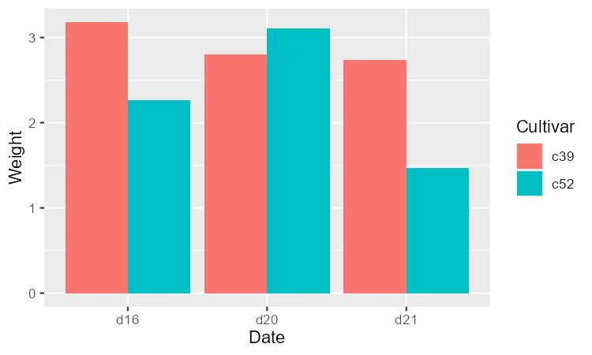

>  图 3.4：分组条形图

### 3.2.3 讨论

基础条形图通常在 x 轴上有一个分类变量，在 y 轴上有一个连续变量。若想按另一个分类变量分组，可以将其映射到 `fill`（填充色），并使用 `position = "dodge"` 使 bar 水平错开；若不加这个参数，会得到堆叠条形图（见 3.7 节）：

- 映射到填充色的变量也必须是分类变量；
- 添加黑色边框：在 `geom_col()` 中使用 `colour = "black"`；
- 设置颜色：使用 `scale_fill_brewer()` 或 `scale_fill_manual()`。

图 3.5 中使用了 `RColorBrewer` 中的 `Pastel1` 调色板：

```r
library(gcookbook)
library(ggplot2)

ggplot(cabbage_exp, aes(x = Date, y = Weight, fill = Cultivar)) +
  geom_col(position = "dodge", colour = "black") +
  scale_fill_brewer(palette = "Pastel1")
```

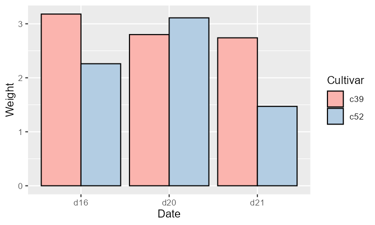

>  图 3.5：带黑色边框和不同调色板的分组条形图

其他美学参数（如 `colour`，即条形边框的颜色）和线型（`linestyle`）也可以用于分组变量，但 `fill`（填充色）最合适。

注意：如果分类变量之间存在缺失的组合，对应的条形就会缺失，而相邻的条形会自动扩展以填补该空间。例如，从示例中删除最后一行：

```R
> ce <- cabbage_exp[1:5, ] 
> ce
  Cultivar Date Weight        sd  n         se
1      c39  d16   3.18 0.9566144 10 0.30250803
2      c39  d20   2.80 0.2788867 10 0.08819171
3      c39  d21   2.74 0.9834181 10 0.31098410
4      c52  d16   2.26 0.4452215 10 0.14079141
5      c52  d20   3.11 0.7908505 10 0.25008887
```

- 画图

```R
ggplot(ce, aes(x = Date, y = Weight, fill = Cultivar)) +
  geom_col(position = "dodge", colour = "black") +
  scale_fill_brewer(palette = "Pastel1")
```

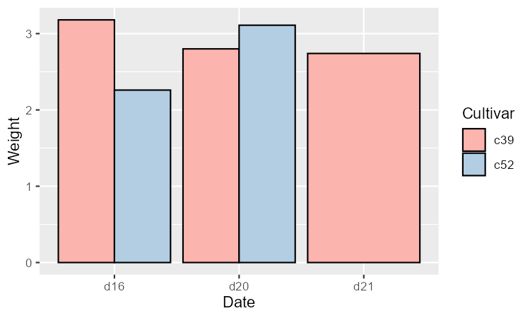

>  图 3.6：缺失条形的图表——另一个条形填补了空间

若存在此问题，可手动为缺失的因子水平组合添加一条记录，并将 y 值设为 `NA`。

### 3.2.4 另请参阅

- 条形图颜色：参阅 3.4 节。
- 根据另一个变量重新排序因子（factor）的级别：15.9 节。

这段关于使用 `ggplot2` 绘制计数条形图的教程文本，用中文可以这样专业且流畅地表达：

## 3.3 计数条形图

### 3.3.1 问题

数据的每行代表一个案例，绘制这些案例的计数（频数）图。

### 3.3.2 解决方案

直接使用 `geom_bar()`，且无需映射 y 轴（图 3.7）：

```r
library(ggplot2)

# 等同于使用 geom_bar(stat = "bin")
ggplot(diamonds, aes(x = cut)) +
  geom_bar()
```

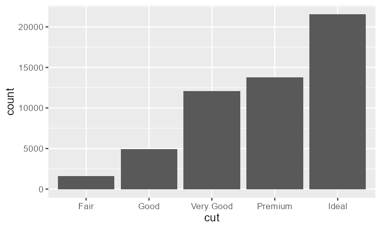

>  图 3.7：计数条形图

### 3.3.3 讨论

`diamonds` 数据集共有 53,940 行，每行代表一颗钻石的信息：

```R
> diamonds
# A tibble: 53,940 × 10
   carat cut       color clarity depth table price     x     y     z
   <dbl> <ord>     <ord> <ord>   <dbl> <dbl> <int> <dbl> <dbl> <dbl>
 1  0.23 Ideal     E     SI2      61.5    55   326  3.95  3.98  2.43
 2  0.21 Premium   E     SI1      59.8    61   326  3.89  3.84  2.31
 3  0.23 Good      E     VS1      56.9    65   327  4.05  4.07  2.31
 4  0.29 Premium   I     VS2      62.4    58   334  4.2   4.23  2.63
 5  0.31 Good      J     SI2      63.3    58   335  4.34  4.35  2.75
 6  0.24 Very Good J     VVS2     62.8    57   336  3.94  3.96  2.48
 7  0.24 Very Good I     VVS1     62.3    57   336  3.95  3.98  2.47
 8  0.26 Very Good H     SI1      61.9    55   337  4.07  4.11  2.53
 9  0.22 Fair      E     VS2      65.1    61   337  3.87  3.78  2.49
10  0.23 Very Good H     VS1      59.4    61   338  4     4.05  2.39
# ℹ 53,930 more rows
# ℹ Use `print(n = ...)` to see more rows
```

`geom_bar()` 默认使用 `stat = "bin"`，统计每个组（本例中为每个 x 位置）的案例数量。该数据集大约有 23,000 个案例为理想切工（`ideal`）。

本例中，x 变量 `cut` 是离散的。如果使用连续变量，则会在每个唯一 x 值处绘制一个条形：

```R
library(ggplot2)

ggplot(diamonds, aes(x = carat)) +
  geom_bar()
```

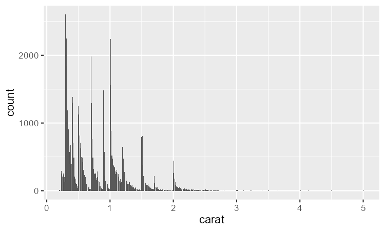

> 图 3.8：具有连续 x 轴的计数条形图

连续变量作为 x 轴的计数条形图类似于直方图，但两者并不相同：

- 在计数条形图中，每个条形代表一个唯一的 x 值；
- 在直方图中，每个条形代表一段 x 值区间。

```R
library(ggplot2)

ggplot(diamonds, aes(x = carat)) +
  geom_histogram()
```

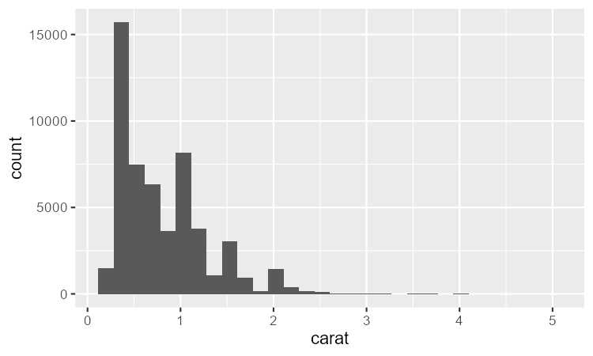

> 图 3.8：直方图

### 3.3.4 另请参阅

- 若数据库已有 y 值列，不需要自动计数，请使用 `geom_col()`。详见 3.1 节。
- 也可以先自行计算计数，再传给 `ggplot()`，请参阅 15.17 节。
- 直方图详情，见 6.1 节。

这段关于在 `ggplot2` 条形图中使用颜色的教程文本，用中文可以这样专业且流畅地表达：

## 3.4 在条形图中使用颜色

### 3.4.1 问题

希望为 bar 使用不同的颜色。

### 3.4.2 解决方案

将合适的变量映射到填充色（`fill`）。

使用 `uspopchange` 示例数据集，该数据集包含美国各州 2000-2010 年人口变化百分比。提取人口增长最快的 10 个州，绘制它们人口变化百分比，并将按地区着色。

- 首先，提取排名前 10 的州

```R
library(gcookbook)
library(dplyr)

upc <- uspopchange |>
  arrange(desc(Change)) |>
  slice(1:10)
```

```R
> upc
            State Abb Region Change
1          Nevada  NV   West   35.1
2         Arizona  AZ   West   24.6
3            Utah  UT   West   23.8
4           Idaho  ID   West   21.1
5           Texas  TX  South   20.6
6  North Carolina  NC  South   18.5
7         Georgia  GA  South   18.3
8         Florida  FL  South   17.6
9        Colorado  CO   West   16.9
10 South Carolina  SC  South   15.3
```

- 将 `Region` 映射到 `fill` 绘图（图 3.9）

```r
ggplot(upc, aes(x = Abb, y = Change, fill = Region)) +
  geom_col()
```

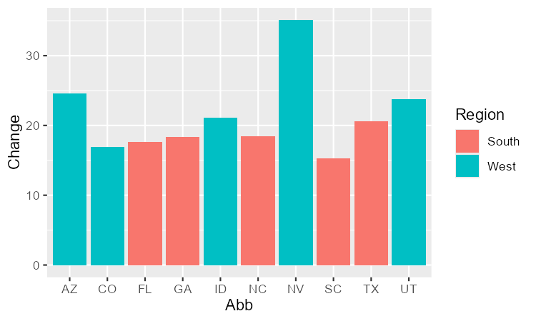

>  图 3.9：将变量映射到填充色

### 3.4.3 讨论

默认颜色通常不够美观，可以使用 `scale_fill_brewer()` 或 `scale_fill_manual()` 设置颜色。下例将使用后者，并用 `colour = "black"` 将 bar 的边框设置为黑色（图 3.10）。注意：在 `aes()` 函数外设置颜色，在 `aes()` 内定义**映射**：

```r
library(gcookbook)
library(dplyr)

upc <- uspopchange |>
  arrange(desc(Change)) |> # 按 Change 从大到小排序
  slice(1:10) # 取前 10 行

# x = reorder(Abb, Change)：x 轴显示州缩写 Abb
# 但按 Change 的大小重新排序，这样条形图会从小到大排列，而不是按字母顺序。
ggplot(upc, aes(x = reorder(Abb, Change), y = Change, fill = Region)) +
  geom_col(colour = "black") +
  scale_fill_manual(values = c("#669933", "#FFCC66")) +
  xlab("State")
```

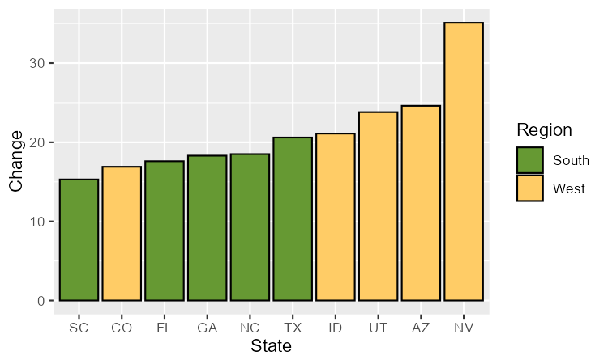

>  图 3.10：使用不同颜色、黑色边框，并按百分比变化排序

说明：

-  `reorder()` 函数根据 `Change` 的值对因子 `Abb` 的级别重新排序，这里按条形高度（数值大小）排序比按字母顺序排序更有意义。
- `scale_fill_manual()` 用于自定义 `fill` 对应的颜色

### 3.4.4 另请参阅

- `reorder()` 的更多信息：请参阅 15.9 节。
- 颜色的更多信息：请参阅第 12 章。

这段关于在条形图中区分正负值颜色的教程文本，用中文可以这样专业且流畅地表达：

## 3.5 正值和负值 bar 使用不同颜色

### 3.5.1 问题

希望为正值和负值 bar 使用不同颜色。

### 3.5.2 解决方案

使用 `climate` 数据集的一个子集，新建 `pos` 列标记正负：

```R
library(gcookbook)
library(dplyr)

climate_sub <- climate |>
  filter(Source == "Berkeley" & Year >= 1900) |>
  mutate(pos = Anomaly10y >= 0)
```

说明：

- `filter(Source == "Berkeley" & Year >= 1900)` 选择 `Source` 等于 `"Berkeley"` 且 `Year >= 1900` 的 rows
- `mutate(pos = Anomaly10y >= 0)` 新增 `pos` 列，如果某行 `Anomaly10y >= 0`，则 `pos` 为 `TRUE`，否则为 `FALSE`

```r
> climate_sub
      Source Year Anomaly1y Anomaly5y Anomaly10y Unc10y   pos
1   Berkeley 1900        NA        NA     -0.171  0.108 FALSE
2   Berkeley 1901        NA        NA     -0.162  0.109 FALSE
3   Berkeley 1902        NA        NA     -0.177  0.108 FALSE
...
103 Berkeley 2002        NA        NA      0.856  0.028  TRUE
104 Berkeley 2003        NA        NA      0.869  0.028  TRUE
105 Berkeley 2004        NA        NA      0.884  0.029  TRUE
```

开始绘图：将 `pos` 映射到 `fill`，并使用 `position = "identity"` 避免因负数不支持堆叠（stacking）而引发的警告信息（图 3.11）：

```r
ggplot(climate_sub, aes(x = Year, y = Anomaly10y, fill = pos)) +
  geom_col(position = "identity")
```

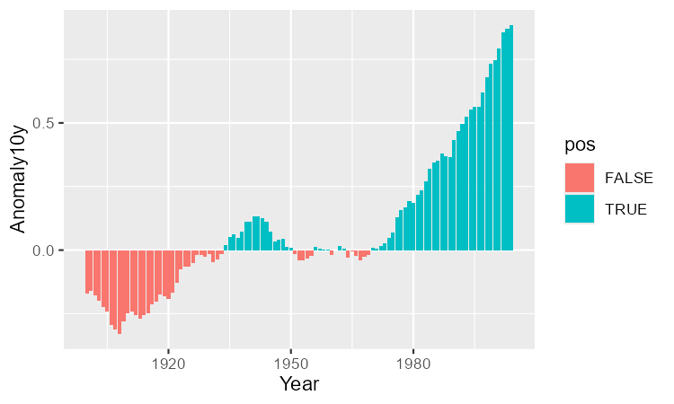

>  图 3.11：正负值使用不同颜色

说明：

- `position = "identity"` 表示不做位置调整，让每个 bar 按数据里原来的位置绘制；
- `geom_col()` 默认使用 `position = "stack"`，也就是堆叠；
- 如果一个 `x` 有多个 bars，默认会上下堆起来；
- 写成 `position = "identity"` 后，bar 不会堆叠，而是直接画在原来位置，当同一个位置有多个 bars 时，它们会相互重叠，后面的会盖住前面的。

### 3.5.3 讨论

上例有两个问题：颜色可能与想要的相反（通常蓝色代表冷，红色代表热）；图例多余。

可以使用 `scale_fill_manual()` 更改颜色，使用 `guide = "none"` 移除图例（图 3.12）：

```R
ggplot(climate_sub, aes(x = Year, y = Anomaly10y, fill = pos)) +
  geom_col(position = "identity", colour = "black") +
  scale_fill_manual(values = c("#CCEEFF", "#FFDDDD"), guide = "none")
```

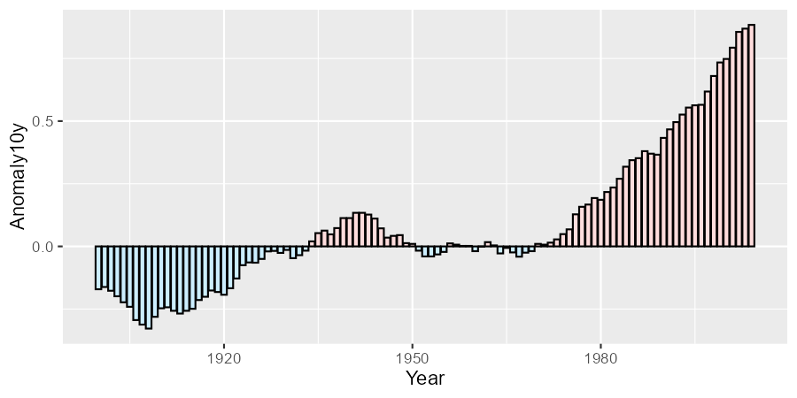

>  图 3.12：自定义颜色且无图例

### 3.5.4 另请参阅

- 有关更改颜色的更多信息：请参阅 12.4 节和 12.5 节。
- 有关隐藏图例的更多信息：请参阅 10.1 节。

## 3.6 调整 bar 宽度与间距

### 3.6.1 问题

希望调整 bar 宽度以及 bar 之间的间距。

### 3.6.2 解决方案

在 `geom_col()` 中设置 `width` 参数调整 bar 宽度，默认为 0.9；值越大 bar 越宽（图 3.13）。

> [!TIP]
>
> `width` 表示 bar 宽度占相邻两个 x 位置之间距离的比例，默认 0.9 表示占 90%。

- 标准宽度

```R
library(gcookbook)
library(ggplot2)

ggplot(pg_mean, aes(x = group, y = weight)) +
  geom_col()
```

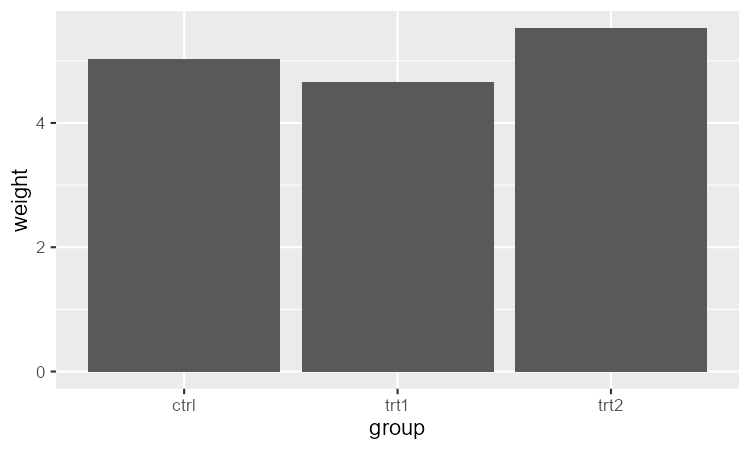

- 绘制较窄的 bar

```r
ggplot(pg_mean, aes(x = group, y = weight)) +
  geom_col(width = 0.5)
```

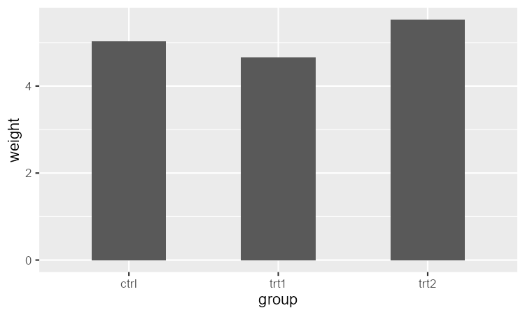

- 绘制较宽的 bar（最大 1）：

```r
ggplot(pg_mean, aes(x = group, y = weight)) +
  geom_col(width = 1)
```

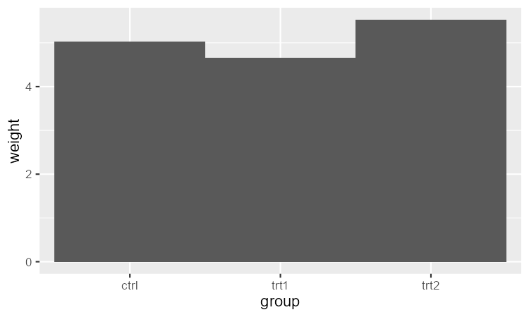

>  图 3.13：不同条形宽度

分组条形图默认组内 bar 之间没有间距。若要添加组内间距，可以减小 `width`，并设置 `position_dodge` 的值大于 `width`（图 3.14）。

- 绘制条形较窄的分组条形图

```R
library(gcookbook)
library(ggplot2)

ggplot(cabbage_exp, aes(x = Date, y = Weight, fill = Cultivar)) +
  geom_col(width = 0.5, position = "dodge")
```

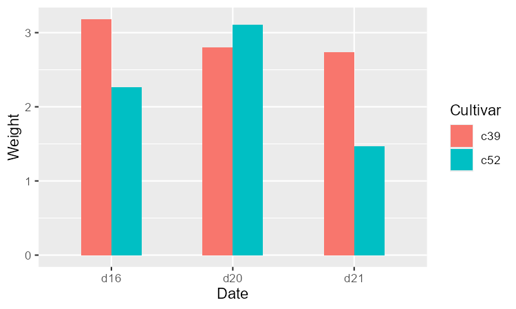

>  图 3.14：条形较窄的分组条形图

- 在 bar 之间添加间距

```r
ggplot(cabbage_exp, aes(x = Date, y = Weight, fill = Cultivar)) +
  geom_col(width = 0.5, position = position_dodge(0.7))
```

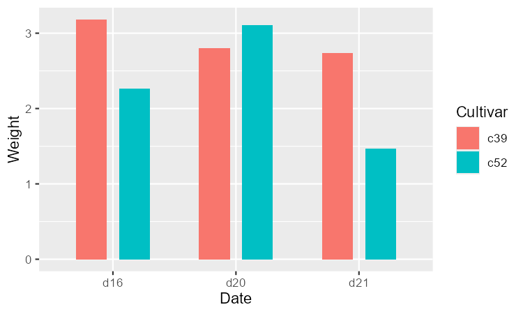

>  图 3.14：带间距的分组条形图

`position = "dodge"` 是 `position = position_dodge()` 的简写形式，默认为 0.9。但在需要设置特定值时，就需要使用完整写法。

### 3.6.3 讨论

条形宽度默认为 0.9，`position_dodge()` 默认也是 0.9：准确地说，`position_dodge()` 中 `width` 默认为 `NULL`，此时 `ggplot2` 会使用与 `geom_bar()` 中相同的 `width` 值。

以下几种写法等价：

```r
geom_bar(position = "dodge")
geom_bar(width = 0.9, position = position_dodge())
geom_bar(position = position_dodge(0.9))
geom_bar(width = 0.9, position = position_dodge(width = 0.9))
```

`geom_bar(width = 0.9)` 使每组在 x 轴上占据 0.9 的宽度；`position_dodge(width = 0.9)` 使每个条形中心与“条形宽度为 0.9 且彼此紧贴”时的中心位置一致。如图 3.15 所示，两图的 dodge 宽度均为 0.9，但上图的条形宽度为 0.9，下图的条形宽度为 0.2。尽管条形宽度不同，但条形的中心依然对齐。

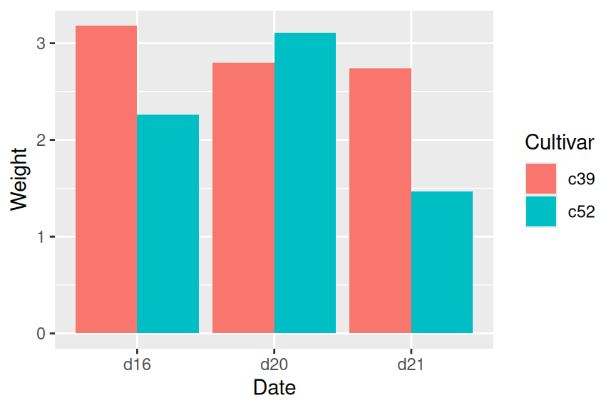

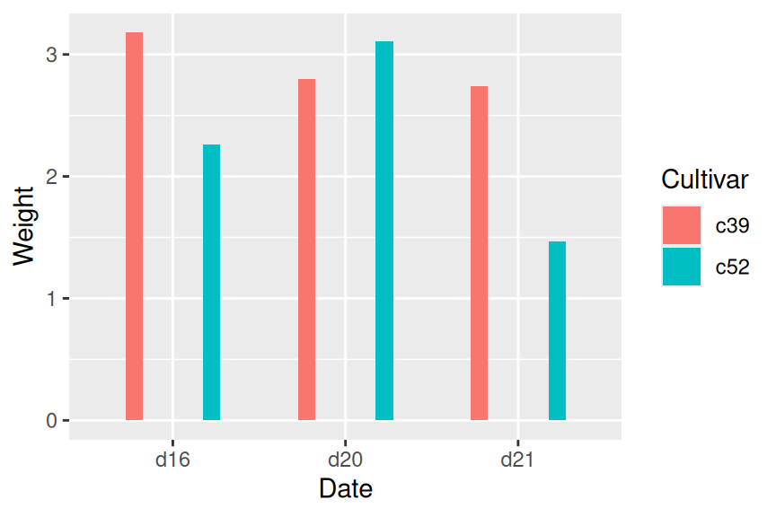

>  图 3.15：相同 dodge 宽度 0.9，但条形宽度分别为 0.9（上）和 0.2（下）

图表变宽或变窄，条形尺寸随之按比例缩放。

## 3.7 堆叠条形图

### 3.7.1 问题

绘制堆叠条形图。

### 3.7.2 解决方案

用 `geom_bar()`（或 `geom_col()`）并将一个变量映射到填充色（`fill`）。这里将 `Date` 放在 x 轴，使用 `Cultivar` 作为填充色（图 3.16）：

```r
library(gcookbook)
library(ggplot2)

ggplot(cabbage_exp, aes(x = Date, y = Weight, fill = Cultivar)) +
  geom_col()
```

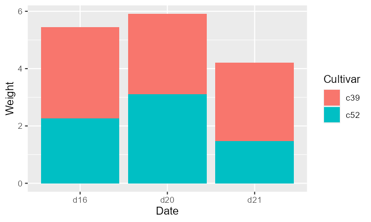

>  图 3.16：堆叠条形图

### 3.7.3 讨论

为了理解图表是如何生成的，了解数据的结构非常重要。数据中 `Date` 有三个水平，`Cultivar` 有两个水平，并且每种组合都有一个对应的 `Weight` 值：

```r
> cabbage_exp
  Cultivar Date Weight        sd  n         se
1      c39  d16   3.18 0.9566144 10 0.30250803
2      c39  d20   2.80 0.2788867 10 0.08819171
3      c39  d21   2.74 0.9834181 10 0.31098410
4      c52  d16   2.26 0.4452215 10 0.14079141
5      c52  d20   3.11 0.7908505 10 0.25008887
6      c52  d21   1.47 0.2110819 10 0.06674995
```

bar 的堆叠顺序默认与图例相同。可以使用 `guides()` 调整图例顺序：

```r
ggplot(cabbage_exp, aes(x = Date, y = Weight, fill = Cultivar)) +
  geom_col() +
  guides(fill = guide_legend(reverse = TRUE))
```

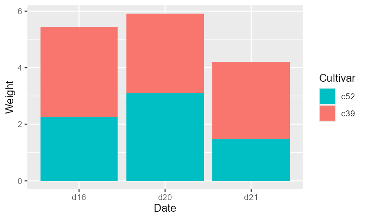

>  图 3.17：图例顺序反转

使用 `position_stack(reverse = TRUE)` 反转 bar 的堆叠顺序（图 3.18），同时反转图例顺序以与条形顺序匹配：

```r
ggplot(cabbage_exp, aes(x = Date, y = Weight, fill = Cultivar)) +
  geom_col(position = position_stack(reverse = TRUE)) +
  guides(fill = guide_legend(reverse = TRUE))
```

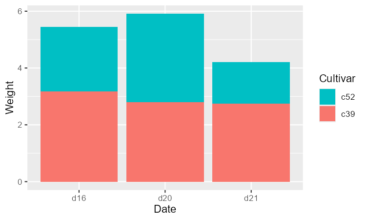

>  图 3.18：堆叠顺序反转

也可以通过修改数据框调整因子（factor）的顺序排列（见 15.8 节），但需谨慎，避免影响其他分析。

美化选项：使用 `scale_fill_brewer()` 换调色板，用 `colour = "black"` 加黑色边框（图 3.19）：

```r
ggplot(cabbage_exp, aes(x = Date, y = Weight, fill = Cultivar)) +
  geom_col(colour = "black") +
  scale_fill_brewer(palette = "Pastel1")
```

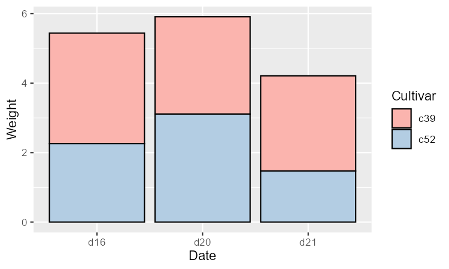

>  图 3.19：新调色板和黑色边框

### 3.7.4 另请参阅

- 条形图颜色：3.4 节。
- 根据另一个变量的值重排因子的级别：15.9 节；手动更改因子级别顺序：15.8 节。

## 3.8 百分比堆叠条形图

### 3.8.1 问题

绘制一个显示比例的堆叠条形图（即 100% 堆叠条形图）。

### 3.8.2 解决方案

使用 `geom_col(position = "fill")`（图 3.20）：

```r
library(gcookbook)
library(ggplot2)

ggplot(cabbage_exp, aes(x = Date, y = Weight, fill = Cultivar)) +
  geom_col(position = "fill")
```

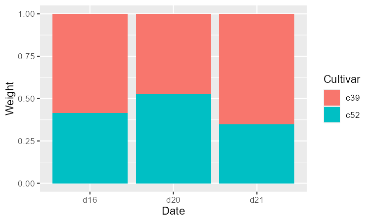

>  图 3.20：百分比堆叠条形图

### 3.8.3 讨论

`position = "fill"` 将 y 轴缩放到 0-1。要显示为百分比，需使用 `scale_y_continuous(labels = scales::percent)`：

```r
ggplot(cabbage_exp, aes(x = Date, y = Weight, fill = Cultivar)) +
  geom_col(position = "fill") +
  scale_y_continuous(labels = scales::percent)
```

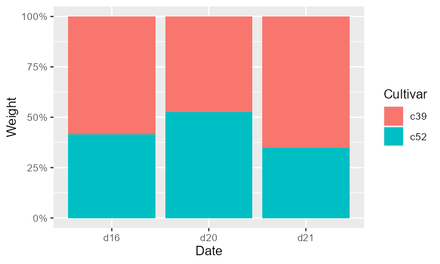

> [!NOTE]
>
> `scales::percent` 是调用 `scales` 包中的 `percent` 函数；也可以先调用 `library(scales)`，再用 `scale_y_continuous(labels = percent)`。

美化：更改调色板并添加边框（图 3.21）：

```r
ggplot(cabbage_exp, aes(x = Date, y = Weight, fill = Cultivar)) +
  geom_col(colour = "black", position = "fill") +
  scale_y_continuous(labels = scales::percent) +
  scale_fill_brewer(palette = "Pastel1")
```

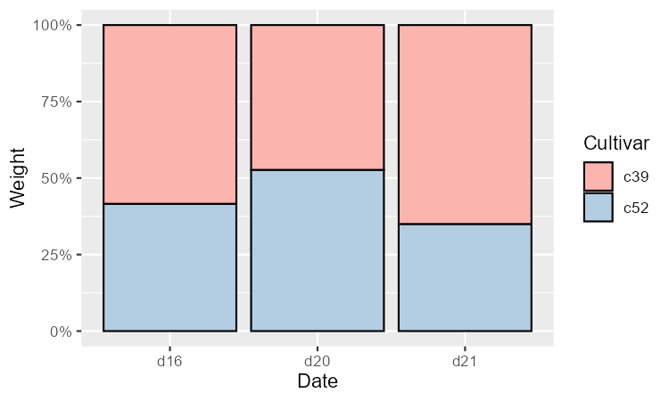

>  图 3.21：新调色板和黑色边框的百分比堆叠条形图

除了让 `ggplot2` 计算，也可以自行计算比例。当需要在其他计算中使用这些值时会非常有用。可以通过使用 `dplyr` 包中的 `group_by()` 和 `mutate()` 函数来实现。

```R
> library(gcookbook)
> library(ggplot2)
> cabbage_exp
  Cultivar Date Weight        sd  n         se
1      c39  d16   3.18 0.9566144 10 0.30250803
2      c39  d20   2.80 0.2788867 10 0.08819171
3      c39  d21   2.74 0.9834181 10 0.31098410
4      c52  d16   2.26 0.4452215 10 0.14079141
5      c52  d20   3.11 0.7908505 10 0.25008887
6      c52  d21   1.47 0.2110819 10 0.06674995
```

```R
ce <- cabbage_exp |>
  group_by(Date) |>
  mutate(percent_weight = Weight / sum(Weight) * 100)
```

```R
> ce
# A tibble: 6 × 7
# Groups:   Date [3]
  Cultivar Date  Weight    sd     n     se percent_weight
  <fct>    <fct>  <dbl> <dbl> <int>  <dbl>          <dbl>
1 c39      d16     3.18 0.957    10 0.303            58.5
2 c39      d20     2.8  0.279    10 0.0882           47.4
3 c39      d21     2.74 0.983    10 0.311            65.1
4 c52      d16     2.26 0.445    10 0.141            41.5
5 c52      d20     3.11 0.791    10 0.250            52.6
6 c52      d21     1.47 0.211    10 0.0667           34.9
```

这里使用 `dplyr` 的 `group_by()` 和 `mutate()` 函数计算每个 `Weight` 组内的百分比。在上例中，`group_by()` 按 `Date` 列，`mutate()` 则添加一个新列，值为每行的 `Weight` 值除以该组内 `Weight` 列的总和。

> [!TIP]
>
> `cabbage_exp` 是常规数据框，而 `ce` 是 tibble，它是带额外属性的数据框。`dplyr` 包会创建 tibble。详见第 15 章。

计算新列后，就可以照常绘制：

```r
ggplot(ce, aes(x = Date, y = percent_weight, fill = Cultivar)) +
  geom_col()
```

### 3.8.4 另请参阅

- 按组转换数据：第 15 章。

## 3.9 在条形图中添加标签

### 3.9.1 问题

在条形图上添加标签。

### 3.9.2 解决方案

使用 `geom_text()` 映射 x、y以及文本。通过 `vjust` 调整文本位置（图 3.22）：

- 标签在 bar 顶部下方

```R
library(gcookbook)
library(ggplot2)

ggplot(cabbage_exp, aes(x = interaction(Date, Cultivar), y = Weight)) +
  geom_col() +
  geom_text(aes(label = Weight), vjust = 1.5, colour = "white")
```

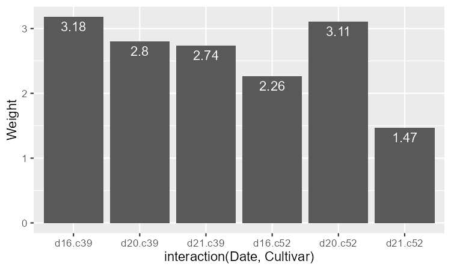

- 标签在 bar 顶部上方

```R
ggplot(cabbage_exp, aes(x = interaction(Date, Cultivar), y = Weight)) +
  geom_col() +
  geom_text(aes(label = Weight), vjust = -0.2)
```

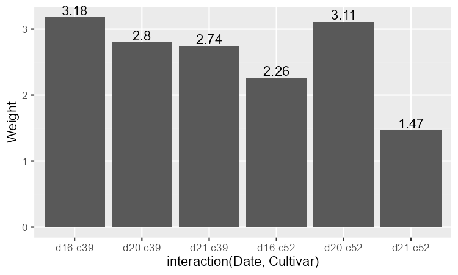

>  图 3.22：标签在条形顶部下方或上方

注意，标签放在条形顶部上方时可能被裁切，解决方案参阅 8.2 节。

计数条形图添加标签： `geom_bar()` +  `geom_text()`：

```r
ggplot(mtcars, aes(x = factor(cyl))) +
  geom_bar() +
  geom_text(aes(label = after_stat(count)),
    stat = "count",
    vjust = 1.5,
    colour = "white"
  )
```

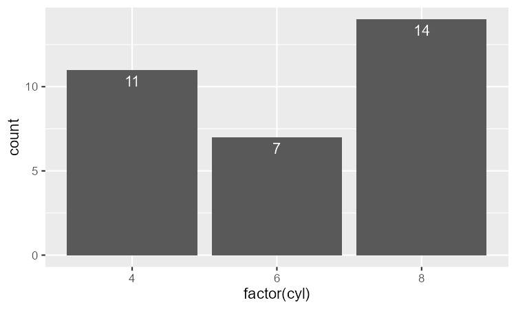

>  图 3.23：带标签的计数条形图，标签位于条形顶部下方

我们要告诉 `geom_text()` 使用 `"count"` 统计量来计算每个 x 值的行数。为了将计数用作标签，这里使用 `aes(label = after_stat(count))` 进行美学映射。

### 3.9.3 讨论

在图 3.22 中，标签的 y 坐标默认居中于每个条形的顶部；通过设置垂直对齐方式（`vjust`），它们可以显示在条形顶部的下方或上方。这种方法的缺点是，当标签位于条形顶部上方时，可能会超出绘图区域的上边界。要解决这个问题，你可以手动设置 y 轴的显示范围，或者直接将文本的 y 坐标设置在条形顶部上方，而不修改垂直对齐方式。直接修改文本 y 坐标的一个缺点是，如果你想将文本完全放在条形顶部的上方或下方，需要增加的具体数值取决于数据的 y 轴范围；相比之下，修改 `vjust` 的值始终会相对于条形的高度移动相同的距离：

```r
# 将 y 轴上限调高一点
ggplot(cabbage_exp, aes(x = interaction(Date, Cultivar), y = Weight)) +
  geom_col() +
  geom_text(aes(label = Weight), vjust = -0.2) +
  ylim(0, max(cabbage_exp$Weight) * 1.05)

# 将 y 坐标映射到条形顶部稍上方的位置 - 绘图区的 y 轴范围会自动调整
ggplot(cabbage_exp, aes(x = interaction(Date, Cultivar), y = Weight)) +
  geom_col() +
  geom_text(aes(y = Weight + 0.1, label = Weight))
```

对于分组条形图，你还需要指定 `position = position_dodge()` 并为其提供错开（dodging）的宽度值。默认的错开宽度为 0.9。由于条形变窄了，你可能需要使用 `size` 参数指定较小的字体，以使标签能够容纳得下。`size` 的默认值为 5，因此我们将其设置为 3（如图 3.24 所示）：

```r
ggplot(cabbage_exp, aes(x = Date, y = Weight, fill = Cultivar)) +
  geom_col(position = "dodge") +
  geom_text(
    aes(label = Weight),
    colour = "white", size = 3,
    vjust = 1.5, position = position_dodge(.9)
  )
```

*图 3.24：分组条形图上的标签*

在堆叠条形图上添加标签，需要计算每个堆叠的累计和。为此，首先要确保数据已正确排序——如果没有正确排序，累计和的计算顺序可能会出错。我们将使用 `dplyr` 包中的 `arrange()` 函数。请注意，我们必须使用 `rev()` 函数来反转 `Cultivar` 的顺序：

```r
library(dplyr)

# 按 Date 和 Cultivar 列进行排序
ce <- cabbage_exp %>%
  arrange(Date, rev(Cultivar))
```

确保数据排序正确后，我们将使用 `group_by()` 按 `Date` 将数据分块，然后计算每个块内 `Weight` 的累计和：

```r
# 计算累计和
ce <- ce %>%
  group_by(Date) %>%
  mutate(label_y = cumsum(Weight))

ce
#> # A tibble: 6 × 7
#> # Groups:   Date [3]
#>   Cultivar Date  Weight    sd     n     se label_y
#>   <fct>    <fct>  <dbl> <dbl> <int>  <dbl>   <dbl>
#> 1 c52      d16     2.26 0.445    10 0.141     2.26
#> 2 c39      d16     3.18 0.957    10 0.303     5.44
#> 3 c52      d20     3.11 0.791    10 0.250     3.11
#> 4 c39      d20     2.8  0.279    10 0.0882    5.91
#> 5 c52      d21     1.47 0.211    10 0.0667    1.47
#> 6 c39      d21     2.74 0.983    10 0.311     4.21

ggplot(ce, aes(x = Date, y = Weight, fill = Cultivar)) +
  geom_col() +
  geom_text(aes(y = label_y, label = Weight), vjust = 1.5, colour = "white")
```

*图 3.25：堆叠条形图上的标签*

结果如图 3.25 所示。

在使用标签时，如果需要更改堆叠顺序，最好在计算累计和之前，通过修改因子（factor）中水平的顺序来实现（参见 15.8 节）。另一种更改堆叠顺序的方法是在 scale 中指定 `breaks`，但这在这里行不通，因为累计和的顺序将与堆叠顺序不一致。

若要将标签放置在每个条形的中间（如图 3.26 所示），必须对累计和进行调整，并且可以去掉 `geom_bar()` 中的 y 轴偏移量：

```r
ce <- cabbage_exp %>%
  arrange(Date, rev(Cultivar))

# 计算 y 轴位置，将其放置在条形中间
ce <- ce %>%
  group_by(Date) %>%
  mutate(label_y = cumsum(Weight) - 0.5 * Weight)

ggplot(ce, aes(x = Date, y = Weight, fill = Cultivar)) +
  geom_col() +
  geom_text(aes(y = label_y, label = Weight), colour = "white")
```

*图 3.26：标签位于堆叠条形中间的图表*

为了使图表更加美观（如图 3.27 所示），我们将更改颜色，使用 `size` 参数在中间添加较小字体的标签，使用 `paste()` 添加 “kg” 后缀，并使用 `format()` 确保小数点后始终保留两位数字：

```r
ggplot(ce, aes(x = Date, y = Weight, fill = Cultivar)) +
  geom_col(colour = "black") +
  geom_text(aes(y = label_y, label = paste(format(Weight, nsmall = 2), "kg")), size = 4) +
  scale_fill_brewer(palette = "Pastel1")
```

*图 3.27：带有标签的自定义堆叠条形图*

**3.9.4 另请参阅**

- 有关控制文本外观的更多信息，请参阅 9.2 节。
- 有关按组转换数据的更多信息，请参阅 15.16 节。

这段关于绘制克利夫兰点图（Cleveland dot plot）的教程文本，用中文可以这样专业且流畅地表达：

## 3.10 绘制 Cleveland 点图

### 3.10.1 问题

你希望绘制一个克利夫兰点图。

**3.10.2 解决方案** 克利夫兰点图是条形图的一种替代方案，它可以减少视觉上的杂乱感，并且通常更易于阅读。

创建点图最简单的方法（如图 3.28 所示）是使用 `geom_point()`：

```r
library(gcookbook) # 加载 gcookbook 包以获取 tophitters2001 数据集
tophit <- tophitters2001[1:25, ] # 从 tophitters 数据集中提取前 25 名

ggplot(tophit, aes(x = avg, y = name)) +
  geom_point()
```

*图 3.28：基础点图*

**3.10.3 讨论**

`tophitters2001` 数据集包含许多列，但在本示例中，我们仅关注其中的三列：

```r
tophit[, c("name", "lg", "avg")]
#>             name lg    avg
#> 1   Larry Walker NL 0.3501
#> 2  Ichiro Suzuki AL 0.3497
#> 3   Jason Giambi AL 0.3423
#>  ...<还有 19 行>...
#> 23  Jeff Cirillo NL 0.3125
#> 24   Jeff Conine AL 0.3111
#> 25   Derek Jeter AL 0.3111
```

在图 3.28 中，名称是按字母顺序排序的，这在当前图表中并不实用。点图通常会按照水平轴上连续变量的值进行排序。

尽管 `tophit` 数据框的行碰巧已经按 `avg` 排序，但这并不意味着图表中的项目也会按此顺序显示。默认情况下，给定轴上的项目会按照适合其数据类型的方式进行排序。`name` 是一个字符向量，因此它按字母顺序排列。如果它是一个因子（factor），则会使用因子水平中定义的顺序。在这个例子中，我们希望 `name` 按另一个变量 `avg` 进行排序。

为此，我们可以使用 `reorder(name, avg)`，它会将 `name` 列转换为因子，并根据 `avg` 对因子水平进行排序。为了进一步改善外观，我们将使用主题系统（theming system）去掉垂直网格线，并将水平网格线改为虚线（如图 3.29 所示）：

```r
ggplot(tophit, aes(x = avg, y = reorder(name, avg))) +
  geom_point(size = 3) +  # 使用较大的点
  theme_bw() +
  theme(
    panel.grid.major.x = element_blank(),
    panel.grid.minor.x = element_blank(),
    panel.grid.major.y = element_line(colour = "grey60", linetype = "dashed")
  )
```

*图 3.29：按击球平均值排序的点图*

也可以交换坐标轴，使名称沿 x 轴分布，数值沿 y 轴分布，如图 3.30 所示。我们还将文本标签旋转 60 度：

```r
ggplot(tophit, aes(x = reorder(name, avg), y = avg)) +
  geom_point(size = 3) +  # 使用较大的点
  theme_bw() +
  theme(
    panel.grid.major.y = element_blank(),
    panel.grid.minor.y = element_blank(),
    panel.grid.major.x = element_line(colour = "grey60", linetype = "dashed"),
    axis.text.x = element_text(angle = 60, hjust = 1)
  )
```

*图 3.30：名称在 x 轴、数值在 y 轴的点图*

有时还需要按另一个变量对项目进行分组。在本例中，我们将使用因子 `lg`，它具有 `NL` 和 `AL` 两个水平，分别代表国家联盟（National League）和美国联盟（American League）。这一次，我们希望先按 `lg` 排序，然后再按 `avg` 排序。遗憾的是，`reorder()` 函数只能根据一个其他变量对因子水平进行排序；若要根据两个变量排序，我们必须手动操作：

```r
# 获取名称，先按 lg 排序，再按 avg 排序
nameorder <- tophit$name[order(tophit$lg, tophit$avg)]

# 将 name 转换为因子，其水平顺序与 nameorder 一致
tophit$name <- factor(tophit$name, levels = nameorder)
```

为了绘制图表（如图 3.31 所示），我们还将把 `lg` 映射到点的颜色上。这次我们不使用贯穿整个绘图区的网格线，而是通过使用 `geom_segment()` 使线条仅延伸到点的位置。请注意，`geom_segment()` 需要提供 `x`、`y`、`xend` 和 `yend` 的值：

```r
ggplot(tophit, aes(x = avg, y = name)) +
  geom_segment(aes(yend = name), xend = 0, colour = "grey50") +
  geom_point(size = 3, aes(colour = lg)) +
  scale_colour_brewer(palette = "Set1", limits = c("NL", "AL")) +
  theme_bw() +
  theme(
    panel.grid.major.y = element_blank(),   # 不显示水平网格线
    legend.position = c(1, 0.55),           # 将图例放在绘图区内
    legend.justification = c(1, 0.5)
  )
```

*图 3.31：按联盟分组，线条仅延伸至点的位置*

另一种区分两个组的方法是使用分面（facets），如图 3.32 所示。分面的显示顺序与图 3.31 中的排序顺序不同；若要更改显示顺序，必须更改 `lg` 变量中因子水平的顺序：

```r
ggplot(tophit, aes(x = avg, y = name)) +
  geom_segment(aes(yend = name), xend = 0, colour = "grey50") +
  geom_point(size = 3, aes(colour = lg)) +
  scale_colour_brewer(palette = "Set1", limits = c("NL", "AL"), guide = FALSE) +
  theme_bw() +
  theme(panel.grid.major.y = element_blank()) +
  facet_grid(lg ~ ., scales = "free_y", space = "free_y")
```

*图 3.32：按联盟分面的点图*

**3.10.4 另请参阅**

- 有关更改因子水平顺序的更多信息，请参阅 15.8 节。有关根据其他值更改因子水平顺序的详细信息，请参阅 15.9 节。
- 有关移动图例的更多信息，请参阅 10.2 节。有关隐藏网格线的信息，请参阅 9.6 节。