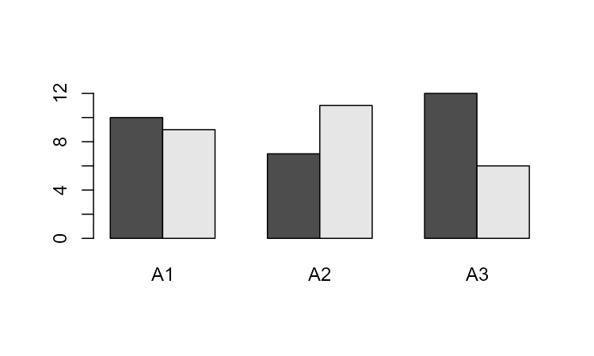

# A. 理解 ggplot2

@since 2026-10-15
@author Jiawei Mao
***

本书多数绘图实例均基于 `ggplot2` 包。ggplot2 最初由 Hadley Wickham 开发，虽不属于 R 语言的基础包，但凭借其功能全面、接口清晰统一、输出效果精美，在 R 社区拥有大量用户群体。

与 R 中其他绘图包不同，`ggplot2` 采用了一套全新的图形构建方法，其名称源于 Leland Wilkinson 提出的**图形语法**（Grammar of Graphics），这是一个描述数据可视化的正式的、结构化的理论框架。

尽管本书以 `ggplot2` 为核心，但这并不意味着它是 R 语言中唯一或最优的绘图工具：

- 快速排除、探索数据时，R 基础绘图往往更高效，尤其是数据尚未按 `ggplot2` 要求结构化时；
- 部分功能 `ggplot2` 无法实现，或实现效果不如其它专用绘图包。

但在绝大多数应用场景下，`ggplot2` 的投入产出比最高，能够生成美观、符合出版标准的高质量图表。

另一款优秀的通用绘图包是由 Deepyan Sarkar 开发的 `lattice`，它是对 Trellis 图形的实现，已作为 R 语言基础的一部分随 R 安装。

## A.1 背景知识

数据可视化的本质，是将数据属性映射为图形视觉特征。数据属性一般为数值或分类变量；视觉特征包含点的 X/Y 坐标、线条颜色、条形高度等。只有完成这种映射，才称得上数据可视化。

直观感受上，用 x 坐标表示一个数字和用颜色表示数字差别很大，但抽象层面二者本质一致。作过图的人大多对此有模糊感知，但很少深入理解。

**图形语法**（Grammar of Graphics）将这种底层共性作为核心思想。在 R 基础图形中，每种数据到视觉属性的映射都是独立的，修改映射关系往往需要重构数据、更换绘图命令，甚至两者都要改动。

下面以 `gcookbook` 包中的 `simpledat` 数据集绘图举例说明：

```r
> library(gcookbook)
> simpledat
   A1 A2 A3
B1 10  7 12
B2  9 11  6
```

以下代码绘制一个简单的分组条形图：X 轴为 A，按 B 分组（图 A.1）：

```r
barplot(simpledat, beside = TRUE)
```


>  图 A.1：使用 `barplot()` 绘制条形图

若想交换变量：X 轴改为 B，按 A 分组，就需要通过转置矩阵重构数据：

```r
> t(simpledat)
   B1 B2
A1 10  9
A2  7 11
A3 12  6
```

利用重构后的数据，我们可以像以前一样创建图表（见图 A.2）：

```r
barplot(t(simpledat), beside=TRUE)
```
*图 A.2：数据转置后的条形图*

我们可能想做的另一件事是用折线而不是条形来表示数据，如图 A.3 所示。要在基础图形中实现这一点，我们需要使用一组完全不同的命令。首先我们调用 `plot()`，告诉 R 创建一个新图并为数据的一行绘制折线。然后我们告诉它为第二行绘制折线：

```r
plot(simpledat[1,], type="l")
lines(simpledat[2,], type="l", col="blue")
```
*图 A.3：使用 plot() 和 lines() 绘制的折线图*

生成的图形有几个小瑕疵。第二条（蓝色）折线跑到了可见范围之外，因为 y 轴的范围仅在调用 `plot()` 函数时根据第一条折线进行了设置。此外，x 轴显示为数值刻度，而不是分类标签。

现在，让我们来看看使用 `ggplot2` 时的对应代码和图形。使用 `ggplot2` 时，数据的结构始终是一致的：它要求数据框采用“长格式（long format）”，而不是前面使用的“宽格式（wide format）”。当数据采用长格式时，每一行代表一个数据项。数据项的分组不是由其在矩阵中的位置决定的，而是在单独的列中指定的。以下是转换为长格式的 `simpledat`：

```r
simpledat_long
#>   Aval Bval value
#> 1   A1   B1    10
#> 2   A1   B2     9
#> 3   A2   B1     7
#> 4   A2   B2    11
#> 5   A3   B1    12
#> 6   A3   B2     6
```

这表示相同的信息，但结构不同。它的另一个术语是“整洁数据（tidy data）”，即每一行代表一个观测值。这种格式有其优缺点，但总体而言，在处理复杂数据集时它使事情变得更简单。有关宽格式和长格式数据之间转换的信息，请参阅 Recipe 15.19 和 Recipe 15.20。

要制作第一个分组条形图（图 A.4），我们首先必须加载 `ggplot2` 包。然后我们告诉它将 `Aval` 映射到 x 轴位置（`x = Aval`），将 `Bval` 映射到填充颜色（`fill = Bval`）。这将使 A 沿 x 轴排列，而 B 决定分组。我们还告诉它将 `value` 映射到条形的 y 轴位置或高度（`y = value`）。最后，我们告诉它使用 `geom_col()` 绘制条形（暂时不用担心其他细节；我们稍后会讲到）：

```r
library(ggplot2)
ggplot(simpledat_long, aes(x = Aval, y = value, fill = Bval)) +
    geom_col(position = "dodge")
```
*图 A.4：使用 ggplot() 和 geom_col() 绘制的条形图*

要调换设置，使 B 沿 x 轴排列，而 A 决定分组（图 A.5），我们只需交换映射规范，即 `x = Bval` 和 `fill = Aval`。与基础图形不同，我们不必更改数据；只需更改绘图命令即可：

```r
ggplot(simpledat_long, aes(x = Bval, y = value, fill = Aval)) +
    geom_col(position = "dodge")
```
*图 A.5：相同数据的条形图，但 x 轴和 fill 映射已互换*

> **注意**
> 你可能已经注意到，在 `ggplot2` 中，图形的各个组件是通过 `+` 运算符组合在一起的。你可以向 `ggplot` 对象逐步添加组件来构建它。然后，当你全部设置完成后，可以将其打印（print）出来。

要将其更改为折线图（图 A.6），我们将 `geom_col()` 更改为 `geom_line()`。我们还将 `Bval` 映射到线条颜色（`colour`），而不是填充颜色（注意这里使用的是英式拼写——`ggplot2` 的作者来自新西兰）。同样，暂时不用担心其他细节：

```r
ggplot(simpledat_long, aes(x = Aval, y = value, colour = Bval, group = Bval)) +
    geom_line()
```
*图 A.6：使用 ggplot() 和 geom_line() 绘制的折线图*

在基础图形中，我们不得不使用完全不同的命令来绘制折线图而不是条形图。而在 `ggplot2` 中，我们只需将几何对象（geom）从条形更改为折线。生成的图形与基础图形版本相比也有重要区别：因为所有折线是一起绘制的而不是一次绘制一条，所以 y 轴范围会自动调整以适应所有数据，并且 x 轴保持为分类轴，而不是转换为数值轴。`ggplot2` 的图形还会自动生成图例。

**A.2 部分术语与理论**

在进一步深入之前，先定义一些 `ggplot2` 中使用的术语会很有帮助：

*   **数据（Data）**：是我们想要可视化的内容。它由变量（variables）组成，这些变量作为数据框（data frame）中的列进行存储。
*   **几何对象（Geoms）**：是绘制出来用于表示数据的几何图形，例如条形、折线和点。
*   **美学属性（Aesthetic attributes）**，或简称**美学映射（aesthetics）**：是几何对象的视觉属性，例如 x 和 y 的位置、线条颜色、点的形状等。
*   数据值与美学属性之间存在**映射（mappings）**关系。
*   **标度（Scales）**：控制数据空间中的值到美学空间中的值之间的映射。例如，连续的 y 轴标度会将较大的数值映射到空间中较高的垂直位置。
*   **引导（Guides）**：向读者展示如何将视觉属性反向映射回数据空间。最常用的引导是坐标轴上的刻度和标签。

下面是一个典型映射是如何运作的示例。你拥有数据（一组数值或分类值），拥有用于表示每个观测值的几何对象，拥有某种美学属性（例如 y 轴垂直位置），并且拥有一个标度（定义了从数据空间即数值，到美学空间即垂直位置的映射）。一个典型的线性 y 轴标度可能会将数值 0 映射到图形的基线，将 5 映射到中间，将 10 映射到顶部。而对数 y 轴标度则会以不同的方式放置它们。

数据和美学空间并不只有上述这些类型。在抽象的图形语法中，数据和美学属性可以是任何东西；而在 `ggplot2` 的具体实现中，有一些预定义的数据和美学属性类型。常用的数据类型包括数值、分类值和文本字符串。常用的美学属性包括水平和垂直位置、颜色、大小和形状。

在解读图形时，读者需要参考引导（guides）。引导的一个例子是 y 轴，包括其刻度和标签。读者通过参考这个引导，来理解当一个点位于标度中间时代表什么含义。图例（legend）是另一种类型的引导。图例可能会向读者说明一个点是圆形或三角形代表什么含义，或者一条线是蓝色或红色代表什么含义。

有些美学属性只能与分类变量配合使用，例如点的形状（三角形、圆形、方形等）。有些美学属性则可以与分类变量或连续变量配合使用，例如 x 轴（水平）位置。对于条形图，变量必须是分类的——如果在 x 轴上使用连续变量将毫无意义。而对于散点图，变量必须是数值型的。这两种类型的数据（分类和数值）都可以映射到 x 轴位置的美学空间，但它们需要不同类型的标度。

> **注意**
> 在 `ggplot2` 的术语中，分类变量被称为**离散（discrete）**变量，而数值变量被称为**连续（continuous）**变量。这些术语的含义可能并不总是与在其他地方的用法一致。有时，在 `ggplot2` 意义上连续的变量，在常规意义上其实是离散的。例如，可见的太阳黑子数量必须是整数，因此它是数值型的（在 `ggplot2` 中属于连续变量），但在日常用语中它是离散的。
>

**A.3 构建简单图形**

`ggplot2` 对数据结构有一个简单的要求：数据必须存储在数据框（data frame）中，并且映射到美学属性的每一种变量都必须存储在各自的列中。在我们前面看过的 `simpledat` 示例中，我们首先将一个变量映射到 x 美学属性，将另一个映射到 fill（填充）美学属性；然后我们通过更改映射规范，来改变哪个变量被映射到了哪个美学属性上。

在这里，我们将通过一个简单的示例来逐步讲解。首先，我们创建一个包含一些示例数据的数据框：

```r
dat <- data.frame(
  xval = 1:4,
  yval = c(3, 5, 6, 9),
  group = c("A", "B", "A", "B")
)

dat
#>   xval yval group
#> 1    1    3     A
#> 2    2    5     B
#> 3    3    6     A
#> 4    4    9     B
```

一个基本的 `ggplot()` 规范看起来像这样：

```r
ggplot(dat, aes(x = xval, y = yval))
```

这会使用数据框 `dat` 创建一个 `ggplot` 对象。它还在 `aes()` 中指定了默认的美学映射：

*   `x = xval` 将 `xval` 列映射到 x 轴位置。
*   `y = yval` 将 `yval` 列映射到 y 轴位置。

在将数据框和美学映射提供给 `ggplot` 之后，还有一个关键组件：我们需要告诉它要添加什么几何对象。此时，`ggplot2` 并不知道我们是想在图形上绘制条形、折线、点还是其他东西。我们将添加 `geom_point()` 来绘制点，从而生成一个散点图（见图 A.7）：

```r
ggplot(dat, aes(x = xval, y = yval)) +
  geom_point()
```

如果你打算重用其中的某些组件，可以将它们存储在变量中。我们可以将 `ggplot` 对象保存在 `p` 中，然后再向其中添加 `geom_point()`。这会产生与前面代码相同的效果：

```r
p <- ggplot(dat, aes(x = xval, y = yval))

p +
  geom_point()
```
*图 A.7：基本散点图*

我们还可以通过在 `geom_point()` 调用内部放入 `aes()` 并指定 `colour = group`，将变量 `group` 映射到点的颜色（见图 A.8）：

```r
p +
  geom_point(aes(colour = group))
```
*图 A.8：将变量映射到颜色的散点图*

这并不会改变我们之前在 `ggplot(...)` 内部定义的默认美学映射。它的作用是为这个特定的几何对象 `geom_point()` 添加一个美学映射。如果我们添加了其他几何对象，这个映射将不会应用于它们。

请将这种“美学映射”与“美学设置”进行对比。这一次，我们不使用 `aes()`；而是直接设置 `colour` 的值（见图 A.9）：

```r
p +
  geom_point(colour = "blue")
```
*图 A.9：直接设置颜色而非映射颜色的散点图*

我们还可以修改标度（scales）；也就是说，修改从数据到视觉属性的映射。在这里，我们将更改 x 轴标度，使其具有更大的范围（见图 A.10）：

```r
p +
  geom_point() +
  scale_x_continuous(limits = c(0, 8))
```
*图 A.10：增加了 x 轴范围的散点图*

如果我们回到带有 `colour = group` 映射的示例，我们还可以修改颜色标度：

```r
p +
  geom_point(aes(colour = group)) +
  scale_colour_manual(values = c("orange", "forestgreen"))
```
*图 A.11：修改了颜色并使用不同调色板的散点图*

在这两次修改标度的操作中，引导（guide）也随之发生了改变。对于 x 轴标度，引导是沿 x 轴的刻度标记。对于颜色标度，引导则是图例。

请注意，我们使用了 `+` 号将各个部分连接在一起。在最后一个示例中，我们在行末使用了 `+` 号，然后在下一行继续添加内容。如果你有多行代码，必须将 `+` 号放在每一行的末尾，而不是下一行的开头。否则，R 的解析器将不知道后面还有代码；它会认为你已经完成了该表达式的编写并直接执行它。

**A.4 打印（Printing）**

在 R 语言的基础图形系统中，绘图函数会直接指示 R 将图形绘制到输出设备（如屏幕或文件）上。`ggplot2` 则略有不同。它的命令不会直接绘制到输出设备，而是构建图形对象（plot objects）。只有当你使用 `print()` 函数（例如 `print(object)`）时，图形才会被真正绘制出来。

你可能会想：“等等，我还没有让 R 打印任何东西，它怎么就把这些图形画出来了呢？” 嗯，这其实并不完全准确。在 R 中，当你在提示符下输入一条命令时，它实际上做了两件事：首先执行该命令，然后调用 `print()` 函数来打印该命令返回的结果。

在 R 的交互式提示符下的行为，与运行脚本或函数时的行为是不同的。在脚本中，命令的结果不会被自动打印。对于函数也是如此，但有一个小细节：函数会返回最后一条命令的执行结果，因此，如果你从 R 提示符下调用该函数，最后一条命令的结果会被打印出来，因为它就是整个函数的返回值。

> **注意**
> 一些 `ggplot2` 的入门教程会使用一个名为 `qplot()` 的函数，它被设计为一个便捷的绘图接口。虽然它比使用 `ggplot()` 加几何对象（geom）少敲几个字，但我发现用起来有点容易让人困惑，因为它指定某些参数的方式有所不同。直接使用 `ggplot()` 反而更简单明了。

**A.5 统计变换（Stats）**

有时，在将数据映射到美学属性之前，必须先对其进行转换或汇总。例如，在绘制直方图时就是如此：数据样本会被划分到不同的区间（bins）中并进行计数，然后每个区间的计数值将被用来指定条形的高度。

虽然像 `geom_histogram()` 这样的某些几何对象会自动为你完成这些操作，但有时你可能希望使用各种 `stat_xx` 函数来手动完成这些统计变换。

**A.6 主题（Themes）**

图形外观的某些方面超出了“图形语法”的范畴。这些方面包括绘图区背景及网格线的颜色、坐标轴标签使用的字体，以及图形标题的文本样式。这些元素通过 `theme()` 函数进行控制，我们将在第 9 章中详细探讨。

**A.7 结语**

希望你现在已经理解了 `ggplot2` 背后的核心概念。本书接下来的内容将为你展示如何实际使用它！