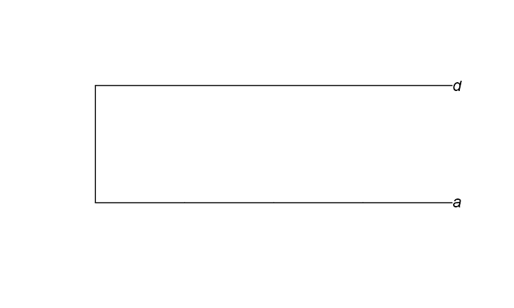

# read.tree

@since 2026-10-16⭐
@author Jiawei Mao

***

读取一个包含一棵或多棵括号格式树的文件，即 Newick 或 New Hampshire 格式。

```R
read.tree(file = "", text = NULL, tree.names = NULL, skip = 0,
    comment.char = "", keep.multi = FALSE, ...)
```

## 参数

### file

文件名，由字符变量或双引号字符串指定；

如果 `file = ""`（默认），则从键盘输入树，空行结束。

### text

包含括号格式树的字符向量：

- `text` 默认为 `NULL`，表示从文件中读取树；
- `text` 不为 `NULL` 时，忽略 `file` 参数。

### tree.names

读取多棵树时，提供每棵树名称的字符向量；为 `NULL`（默认）时树将被命名为 "tree1", "tree2", ...

### skip

读取数据前跳过的行数（此参数直接传递给 `scan()`）。

### comment.char

单个注释字符，每行此字符后的内容被忽略（此参数直接传递给 `scan()`）。

### keep.multi

为 `TRUE` 时，且 `tree.names = NULL`，单棵树也以 `multiPhylo` 返回，并保留文件中的名称。默认为 `FALSE`。

### ...

传递给 `scan()` 的其他参数。

## 详细说明 

`file` 默认允许从键盘输入树，或从编辑器粘贴到 R 控制台，例如：`mytree <- read.tree()`。

`read.tree` 会尽量解析根分支出错的树（如多了一对括号）。例如，`"((A:1,B:1):10);"` 会按 `"(A:1,B:1):10;"` 读取，但会警告，因为前者不是有效的 Newick 格式。若有两个根分支，如 `"(((A:1,B:1):10):10);"`），则无法读取并报错。

如果某行第一个 `"("` 前有字符，这些字符将会作为树的名称；当返回 `multiPhylo` 对象且 `tree.names = NULL` 时，会返回这些名称。

在 ape 4.1 及更早版本中，`comment.char` 默认为 `"#"`（同 `scan`）；该默认设置已更改，以便读取扩展 Newick 文件。

## 返回值

返回 `phylo` 类对象，包含：

- **edge**：一个两列数值型矩阵，每行代表一条边；节点和末端（叶子）用数字表示；末端编号为 1, 2, ...，内部节点编号在末端之后。每行第一列代表祖先节点。
- **edge.length**（可选）：数值向量，`edge` 中各分支长度。
- **tip.label**：字符向量，末端节点名称；顺序与 `edge` 中的（正）编号对应。
- **Nnode**：内部节点数。
- **node.label**（可选）：字符向量，内部节点名称。
- **root.edge** （可选）：数值，根分支长度（若存在）。

如果从文件中读取多棵树，则返回 `multiPhylo` 类，即 `phylo` 对象列表。每棵树的名称可通过 `tree.names` 指定，也可以从文件中读取。

## 示例

- 完成流程演示

```R
# 1. Newick 数字符串：猫头鹰物种进化树
s <- "owls(((Strix_aluco:4.2,Asio_otus:4.2):3.1,Athene_noctua:7.3):6.3,Tyto_alba:13.5);"

# 2. 创建临时文件名，前缀 tree，后缀 .tre
treefile <- tempfile("tree", fileext = ".tre")

# 3. 将 Newick 字符串写入临时文件
cat(s, file = treefile, sep = "\n")

# 4. 读取树文件
tree.owls <- read.tree(treefile)

# 5. 查看树结构
str(tree.owls)
# List of 4
#  $ edge       : int [1:6, 1:2] 5 6 7 7 6 5 6 7 1 2 ...
#  $ edge.length: num [1:6] 6.3 3.1 4.2 4.2 7.3 13.5
#  $ Nnode      : int 3
#  $ tip.label  : chr [1:4] "Strix_aluco" "Asio_otus" "Athene_noctua" "Tyto_alba"
#  - attr(*, "class")= chr "phylo"
#  - attr(*, "order")= chr "cladewise"

# 6. 在控制台打印 tree 基本信息
tree.owls
#
# Phylogenetic tree with 4 tips and 3 internal nodes.
# 
# Tip labels:
#   Strix_aluco, Asio_otus, Athene_noctua, Tyto_alba
# 
# Rooted; includes branch length(s).

# 7. 强制以多棵树 list 形式读取（即使只有一棵树）
tree.owls <- read.tree(treefile, keep.multi = TRUE)

# 8. 打印信息
tree.owls
# 1 phylogenetic tree

# 9. 获取每棵树的名称
names(tree.owls)
# [1] "owls"

# 10. 删除临时文件
unlink(treefile)
```

- 使用 `text` 选项

```R
> TREE <- "((Strix_aluco:4.2,Asio_otus:4.2):3.1,Athene_noctua:7.3);"
> TREE
[1] "((Strix_aluco:4.2,Asio_otus:4.2):3.1,Athene_noctua:7.3);"
> tree.owls.bis <- read.tree(text = TREE)
> str(tree.owls.bis)
List of 4
 $ edge       : int [1:4, 1:2] 4 5 5 4 5 1 2 3
 $ edge.length: num [1:4] 3.1 4.2 4.2 7.3
 $ Nnode      : int 2
 $ tip.label  : chr [1:3] "Strix_aluco" "Asio_otus" "Athene_noctua"
 - attr(*, "class")= chr "phylo"
 - attr(*, "order")= chr "cladewise"
> tree.owls.bis

Phylogenetic tree with 3 tips and 2 internal nodes.

Tip labels:
  Strix_aluco, Asio_otus, Athene_noctua

Rooted; includes branch length(s).
```

- 单个 node 的树

```r
> ts <- read.tree(text = "((((a))),d);")
> plot(ts, node.depth = 2)
```



```R
> nodelabels()
```

