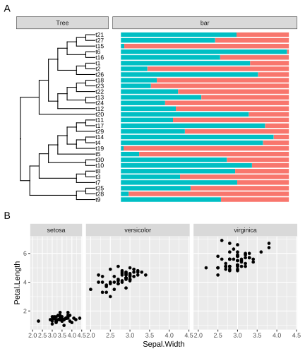
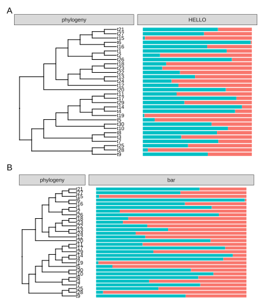
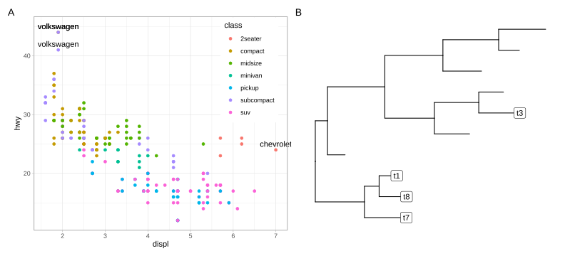
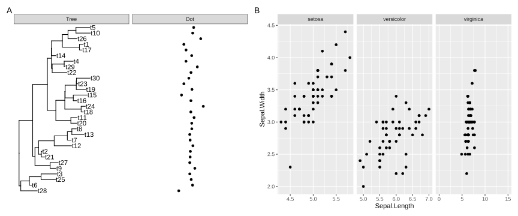
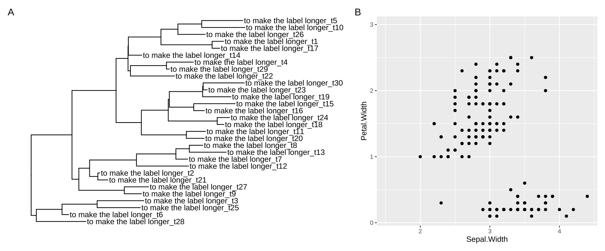
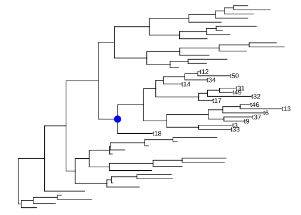
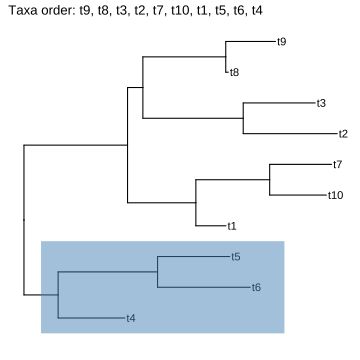
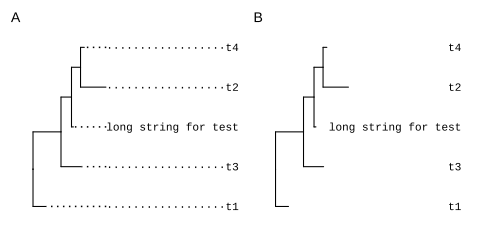

# 12. ggtree 实用工具

@since 2026-10-16⭐
@author Jiawei Mao

***

**12.1 分面（Facet）实用工具**

**12.1.1 facet_widths**

调整分面面板的相对宽度是一个常见的需求，尤其是在使用 `geom_facet()` 将系统发育树与相关数据结合进行可视化时。然而，`ggplot2` 包本身并不支持这一功能。为了解决这个问题，`ggtree` 提供了 `facet_widths()` 函数，该函数同时适用于 `ggtree` 和 `ggplot` 对象。

```R
library(ggplot2)
library(ggtree)
library(reshape2)

set.seed(123)
tree <- rtree(30)

p <- ggtree(tree, branch.length = "none") + 
    geom_tiplab() + theme(legend.position='none')

a <- runif(30, 0,1)
b <- 1 - a
df <- data.frame(tree$tip.label, a, b)
df <- melt(df, id = "tree.tip.label")

p2 <- p + geom_facet(panel = 'bar', data = df, geom = geom_bar, 
                 mapping = aes(x = value, fill = as.factor(variable)), 
                 orientation = 'y', width = 0.8, stat='identity') + 
        xlim_tree(9)

facet_widths(p2, widths = c(1, 2))
```

这句话的中文翻译是：

**它还支持使用命名向量（name vector）来设置特定面板的宽度。以下代码将显示与图 12.1A 完全相同的图形。**

------

**💡 补充说明：**

- **name vector（命名向量）**：在 R 语言中，这是指带有名称属性的向量（例如 `c(Panel_A = 2, Panel_B = 1)`）。通过这种方式，你可以直接指定具体哪个面板需要多宽，而不需要按照默认的顺序去设置，这在 `ggtree` 等复杂排版中非常实用。

```R
facet_widths(p2, c(Tree = .5))
```

**`facet_widths()` 函数同样适用于其他 `ggplot` 对象，如图 12.1B 所示。**

```R
p <- ggplot(iris, aes(Sepal.Width, Petal.Length)) + 
  geom_point() + facet_grid(.~Species)
facet_widths(p, c(setosa = .5))
```



> **图 12.1：调整 ggplot 分面的相对宽度。`facet_widths()` 函数既适用于 `ggtree` (A)，也适用于 `ggplot` (B)。**

**12.1.2 facet_labeller**

`facet_labeller()` 函数旨在为选定的分面重新设置标签（如图 12.2 所示），目前它仅适用于 `ggtree` 对象（即 `geom_facet()` 的输出结果）。在 `ggfun` 包中实现了一个功能更全面的版本（即 `facet_set()` 函数），该版本同时兼容 `ggtree` 和 `ggplot` 对象。

```r
facet_labeller(p2, c(Tree = "phylogeny", bar = "HELLO"))
```

如果你想将 `facet_widths()` 与 `facet_labeller()` 结合使用，**必须**先调用 `facet_labeller()` 来重新设置面板标签，然后再使用 `facet_widths()` 来设置各个面板的相对宽度。否则该操作将失效，因为 `facet_widths()` 的输出是基于网格（grid）对象重新绘制的。

```r
facet_labeller(p2, c(Tree = "phylogeny")) %>% facet_widths(c(Tree = .4))
```



> **图 12.2：重命名分面标签。支持同时重命名多个标签 (A)，或仅重命名特定标签 (B)。`facet_labeller()` 可与 `facet_widths()` 结合使用，以重命名分面标签并随后调整相对宽度 (B)。**

**12.2 几何图层（Geometric Layers）**

`ggplot2` 中定义的图层不支持取子集（subsetting）操作，但这在系统发育树的注释中非常有用，因为它允许我们仅针对特定的节点进行注释（例如：只标记大于 75 的 Bootstrap 支持率值）。

在 `ggtree` 中，我们提供了几个 `ggplot2` 图层的修改版本，以支持子集美学映射（subset aesthetic mapping），包括：

- `geom_segment2()`
- `geom_point2()`
- `geom_text2()`
- `geom_label2()`

这些图层既适用于 `ggtree`，也适用于 `ggplot2`（如图 12.3 所示）。

```R
library(ggplot2)
library(ggtree)
data(mpg)
p <- ggplot(data = mpg, mapping = aes(x = displ, y = hwy)) +
   geom_point(mapping = aes(color = class)) + 
   geom_text2(aes(label=manufacturer, 
                  subset = hwy > 40 | displ > 6.5), 
                  nudge_y = 1) +
   coord_cartesian(clip = "off") +
   theme_light() +
   theme(legend.position = c(.85, .75))          

p2 <- ggtree(rtree(10)) + 
    geom_label2(aes(subset = node <5, label = label))

plot_list(p, p2, ncol=2, tag_levels='A')
```



> **图 12.3：支持取子集（subsetting）操作的几何图层。这些图层既适用于 `ggplot2` (A)，也适用于 `ggtree` (B)。**

以下是这段文本的中文翻译：

**12.3 布局实用工具（Layout Utilities）**

在第 4.2 节中，我们介绍了 `ggtree` 支持的几种布局。此外，`ggtree` 包还提供了一系列布局转换函数，用于在不同布局之间进行转换。请注意，并非所有布局都支持相互转换（详见表 12.1 和图 12.4）。

**表 12.1：布局转换函数**

| 布局函数                 | 描述                                                 |
| ------------------------ | ---------------------------------------------------- |
| `layout_circular`        | 将矩形布局（rectangular）转换为环形布局（circular）  |
| `layout_dendrogram`      | 将矩形布局转换为树状图布局（dendrogram）             |
| `layout_fan`             | 将矩形/环形布局转换为扇形布局（fan）                 |
| `layout_rectangular`     | 将环形/扇形布局转换为矩形布局                        |
| `layout_inward_circular` | 将矩形/环形布局转换为向内环形布局（inward_circular） |

```R
set.seed(2019)
x <- rtree(20)
p <- ggtree(x)
p + layout_dendrogram()
ggtree(x, layout = "circular") + layout_rectangular()
p + layout_circular()
p + layout_fan(angle=90)
p + layout_inward_circular(xlim=4) + geom_tiplab(hjust=1)
```


> **图 12.4：用于在不同布局之间进行转换的布局函数。**
> 默认矩形布局 (A)；将矩形布局转换为树状图布局 (B)；将环形布局转换为矩形布局 (C)；将矩形布局转换为环形布局 (D)；将矩形布局转换为扇形布局 (E)；将矩形布局转换为向内环形布局 (F)。

**12.4 标度（Scale）实用工具**

`ggtree` 包提供了几个用于操作 x 轴的标度函数，包括在第 5.2.4 节中记录的 `scale_x_range()`，以及 `xlim_tree()`、`xlim_expand()`、`ggexpand()`、`hexpand()` 和 `vexpand()`。

**12.4.1 为特定分面面板扩展 x 轴范围**

有时我们需要为特定的分面面板设置 x 轴范围（例如，为“Tree”面板中较长的末端标签分配更多空间）。然而，`ggplot2::xlim()` 函数会应用于所有面板。`ggtree` 提供了 `xlim_expand()` 函数，用于调整用户指定的分面面板的 x 轴范围。它接受两个参数：`xlim` 和 `panel`，并且可以像图 12.5A 演示的那样调整各个独立面板。如果你只想调整“Tree”面板的 x 轴范围，可以使用 `xlim_tree()` 作为快捷方式。

```r
set.seed(2019-05-02)
x <- rtree(30)
p <- ggtree(x) + geom_tiplab()
d <- data.frame(label = x$tip.label, 
                value = rnorm(30))
p2 <- p + geom_facet(panel = "Dot", data = d, 
            geom = geom_point, mapping = aes(x = value))
p2 + xlim_tree(6) + xlim_expand(c(-10, 10), 'Dot')
```

`xlim_expand()` 函数同样适用于 `ggplot2::facet_grid()`。如图 12.5B 所示，只有 `virginica`（维吉尼亚鸢尾）面板的 x 轴范围通过 `xlim_expand()` 进行了调整。

```r
g <- ggplot(iris, aes(Sepal.Length, Sepal.Width)) + 
    geom_point() + facet_grid(. ~ Species, scales = "free_x") 
g + xlim_expand(c(0, 15), 'virginica')
```



> **图 12.5：为用户指定的分面面板设置 x 轴范围（xlim）。**
> 使用 `xlim_tree()` 设置 `ggtree` 输出结果中的 Tree 面板 (A)；使用 `xlim_expand()` 设置 `ggtree` 输出结果中的 Dot 面板 (A) 以及 `ggplot` 输出结果中的 Virginica 面板 (B)。

**12.4.2 按坐标轴范围的比例扩展绘图区域**

`ggplot2` 包无法自动调整绘图区域的坐标轴范围，因此长文本被截断是非常常见的情况。用户需要通过 `xlim()`（或 `ylim()`）命令手动调整 x 轴（或 y 轴）的范围（另见常见问题解答：末端标签被截断）。

虽然 `xlim()`（或 `ylim()`）是解决此问题的有效方法，但我们可以进一步简化这一操作：无需知道具体的坐标轴数值，只需按坐标轴范围的一定比例来扩展绘图面板即可。

我们提供了 `hexpand()` 函数，通过指定 x 轴范围的一个比例值来扩展 x 轴范围。该函数支持向两个方向扩展（`direction=1` 表示向右扩展，`direction=-1` 表示向左扩展）（如图 12.6 所示）。此外，`vexpand()` 函数的作用与 `hexpand()` 类似，但专门用于扩展 y 轴；而 `ggexpand()` 函数则可以同时扩展 x 轴和 y 轴（如图 11.2 所示）。

```r
x$tip.label <- paste0('to make the label longer_', x$tip.label)
p1 <- ggtree(x) + geom_tiplab() + hexpand(.4)
p2 <- ggplot(iris, aes(Sepal.Width, Petal.Width)) + 
    geom_point() + 
    hexpand(.2, direction = -1) +
    vexpand(.2)

plot_list(p1, p2, tag_levels="A", widths=c(.6, .4))
```



> **图 12.6：按 x 轴或 y 轴范围的一定比例扩展绘图区域。**
> 默认在右侧扩展 x 轴范围 (A)；当设置 `direction = -1` 时在左侧扩展 x 轴范围，并在上方扩展 y 轴范围 (B)。

**12.5 树数据实用工具（Tree data utilities）**

**12.5.1 过滤树数据（Filter tree data）**

`ggtree` 包定义了几种支持对树数据进行取子集（subsetting）操作的几何图层。然而，`ggplot2` 及其扩展包中定义的许多其他几何图层并不具备此功能。为了使这些图层也能实现树数据的过滤，`ggtree` 提供了一个配套函数 `td_filter()`。该函数会返回一个与 `dplyr::filter()` 功能相似的函数，可以将其传递给几何图层的 `data` 参数，从而对 `ggtree` 的绘图数据进行过滤，如图 12.7 所示。

```R
library(tidytree)

set.seed(1997)
tree <- rtree(50)
p <- ggtree(tree) 
selected_nodes <- offspring(p, 67)$node
p + geom_text(aes(label=label), 
            data=td_filter(isTip & 
                        node %in% selected_nodes), 
            hjust=0) +
    geom_nodepoint(aes(subset = node ==67), 
                    size=5, color='blue')
```



> **图 12.7：在几何图层中过滤 `ggtree` 的绘图数据。图中仅对选定的末端节点（即蓝圈所示节点的后代）进行了标签标注。**

**12.5.2 展平列表列形式的树数据（Flatten list-column tree data）**

`ggtree` 的绘图数据是一个整洁数据框（tidy data frame），其中每一行代表一个唯一的节点。如果某个节点关联了多个值，这些数据可以存储为嵌套数据（即列表列，list-column）。

```r
set.seed(1997)
tr <- rtree(5)
d <- data.frame(id=rep(tr$tip.label,2), 
                value=abs(rnorm(10, 6, 2)), 
                group=c(rep("A", 5),rep("B",5)))

require(tidyr)
d2  <- nest(d, value =value, group=group)
## d2 is a nested data
d2
```

```
## # A tibble: 5 × 3
##   id    value            group           
##   <chr> <list>           <list>          
## 1 t2    <tibble [2 × 1]> <tibble [2 × 1]>
## 2 t1    <tibble [2 × 1]> <tibble [2 × 1]>
## 3 t5    <tibble [2 × 1]> <tibble [2 × 1]>
## 4 t4    <tibble [2 × 1]> <tibble [2 × 1]>
## 5 t3    <tibble [2 × 1]> <tibble [2 × 1]>
```


`%<+%` 操作符支持嵌套数据，并可以将其映射到树结构中。如果某个几何图层（geom layer）不能直接支持嵌套数据的可视化，我们需要在应用该图层之前先将数据展平。`ggtree` 包提供了一个 `td_unnest()` 函数，它返回一个与 `tidyr::unnest()` 功能相似的函数，可用于展平 `ggtree` 的绘图数据，如图 12.8A 所示。

所有的树数据实用工具（tree data utilities）都提供了一个 `.f` 参数，用于传递一个函数来对数据进行预处理。这为组合使用不同的树数据实用工具创造了可能，如图 12.8B 所示。

```r
p <- ggtree(tr) %<+% d2
p2 <- p + 
    geom_point(aes(x, y, size= value, colour=group), 
            data = td_unnest(c(value, group)), alpha=.4) +
    scale_size(range=c(3,10), limits=c(3, 10))

p3 <- p + 
    geom_point(aes(x, y, size= value, colour=group), 
            data = td_unnest(c(value, group), 
                        .f = td_filter(isTip & node==4)), 
            alpha=.4) +
    scale_size(range=c(3,10), limits=c(3, 10))

plot_list(p2, p3, tag_levels = 'A')
```


> **图 12.8：展平 `ggtree` 的绘图数据。**
> 列表列（List-columns）可以通过 `td_unnest()` 进行展平，从而在每个末端节点（tip）上同时显示两个圆点 (A)。不同的树数据实用工具可以组合使用，例如，先通过 `td_filter()` 过滤数据，然后再通过 `td_unnest()` 将其展平 (B)。

**12.6 树实用工具（Tree Utilities）**

**12.6.1 提取末端节点顺序（Extract tip order）**

在创建组合图（composite plots）时，用户需要在绘制与树相关的图形之前，手动对数据进行重新排序。数据的排列顺序必须与 `ggtree()` 绘图中显示的末端节点（tip）顺序保持一致。为此，我们提供了 `get_taxa_name()` 函数，用于基于 `ggtree()` 绘制的树结构，提取出一个按顺序排列的末端节点向量。

```r
set.seed(123)
tree <- rtree(10)
p <- ggtree(tree) + geom_tiplab() + 
    geom_hilight(node = 12, extendto = 2.5)

x <- paste("Taxa order:", 
        paste0(get_taxa_name(p), collapse=', '))
p + labs(title=x)
```



> **图 12.9：用于演示 `get_taxa_name()` 函数的示例树。**

`get_taxa_name()` 函数会根据图 12.9 中显示的树结构，返回一个按顺序排列的末端节点（tip）标签向量。

```r
get_taxa_name(p)
```

```R
##  [1] "t9"  "t8"  "t3"  "t2"  "t7"  "t10" "t1"  "t5" 
##  [9] "t6"  "t4"
```

如果用户指定了某个节点（node），`get_taxa_name()` 将提取该选定进化枝（clade）的末端节点顺序（即图 12.9 中高亮显示的区域）。

```r
get_taxa_name(p, node = 12)
```

```R
## [1] "t5" "t6" "t4"
```

**12.6.2 填充分类单元标签（Padding taxa labels）**

`label_pad()` 函数用于在分类单元标签中添加填充字符（默认为中间点 `·`）。

```R
set.seed(2015-12-21)
tree <- rtree(5)
tree$tip.label[2] <- "long string for test"

d <- data.frame(label = tree$tip.label, 
                newlabel = label_pad(tree$tip.label),
                newlabel2 = label_pad(tree$tip.label, pad = " "))
print(d)
```

```
##                  label             newlabel
## 1                   t1 ··················t1
## 2 long string for test long string for test
## 3                   t2 ··················t2
## 4                   t4 ··················t4
## 5                   t3 ··················t3
##              newlabel2
## 1                   t1
## 2 long string for test
## 3                   t2
## 4                   t4
## 5                   t3
```

如果希望将末端节点的标签对齐到末端（如图 12.10 所示），这个功能将非常有用。需要注意的是，在这种情况下，应使用等宽字体（monospace font），以确保图中显示的标签长度一致。

```R
p <- ggtree(tree) %<+% d + xlim(NA, 5)
p1 <- p + geom_tiplab(aes(label=newlabel), 
                    align=TRUE, family='mono',
                    linetype = "dotted", linesize = .7) 
p2 <- p + geom_tiplab(aes(label=newlabel2), 
                    align=TRUE, family='mono',
                    linetype = NULL, offset=-.5) + xlim(NA, 5)
plot_list(p1, p2, ncol=2, tag_levels = "A")                            
```



> **图 12.10：将末端节点标签对齐至末端。**
> (A) 带有虚线；(B) 不带虚线。

## 12.7 交互式 `ggtree` 注释

`ggtree` 实现了 `identify()` 方法，支持交互式树注释或操作：点击节点可高亮进化枝、为其添加标签、旋转分支等。还可以使用 `plotly` 将 `ggtree` 对象转换为 `plotly` 对象，创建交互式系统发育树。


> 图 12.11：使用 `identify()` 创建的交互式系统发育树，支持进化枝高亮、添加标签与分支旋转。
