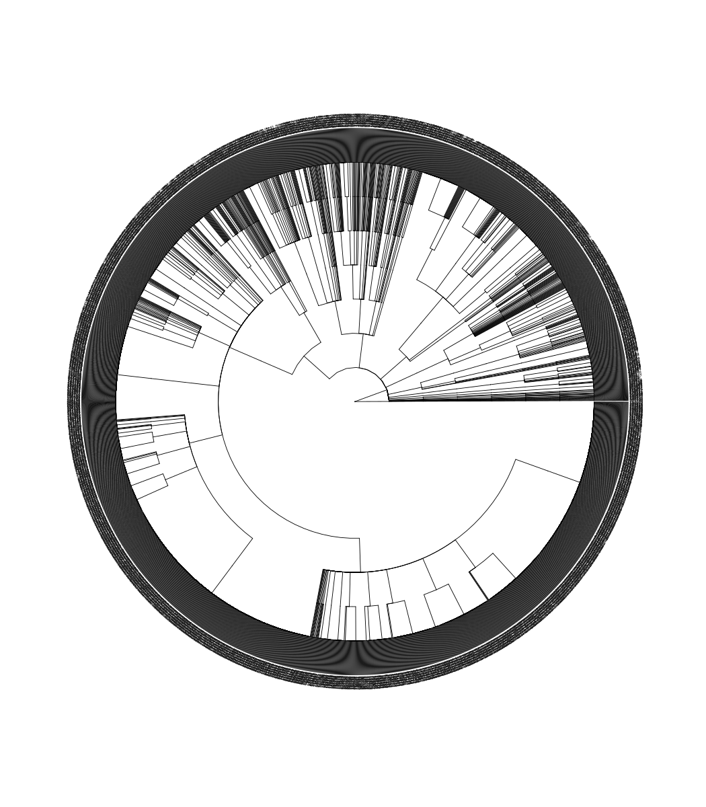
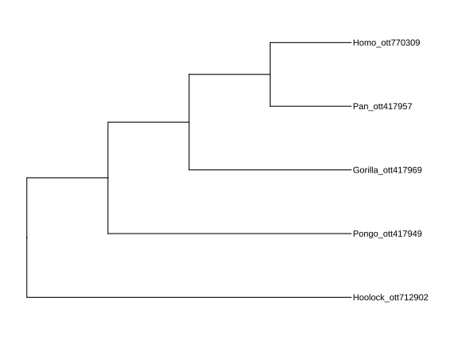
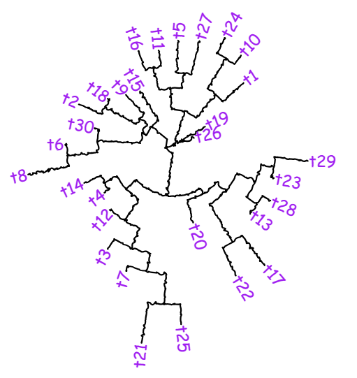
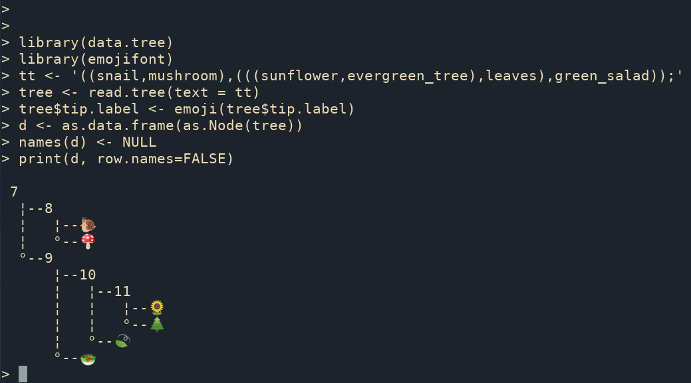
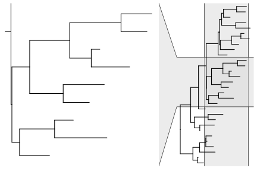
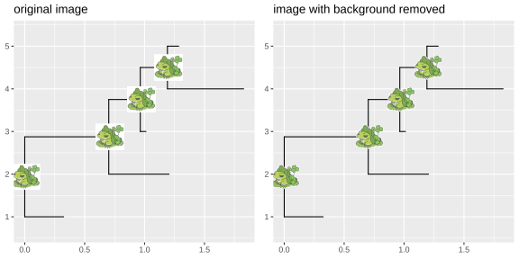
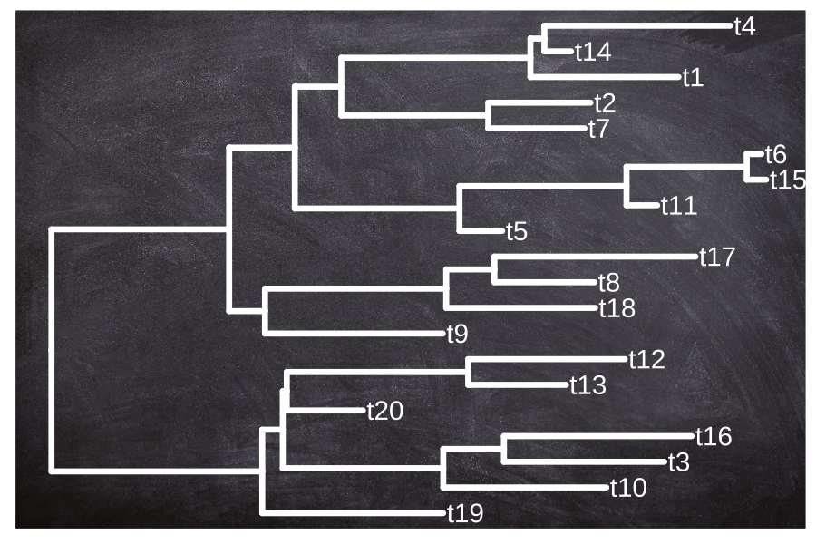
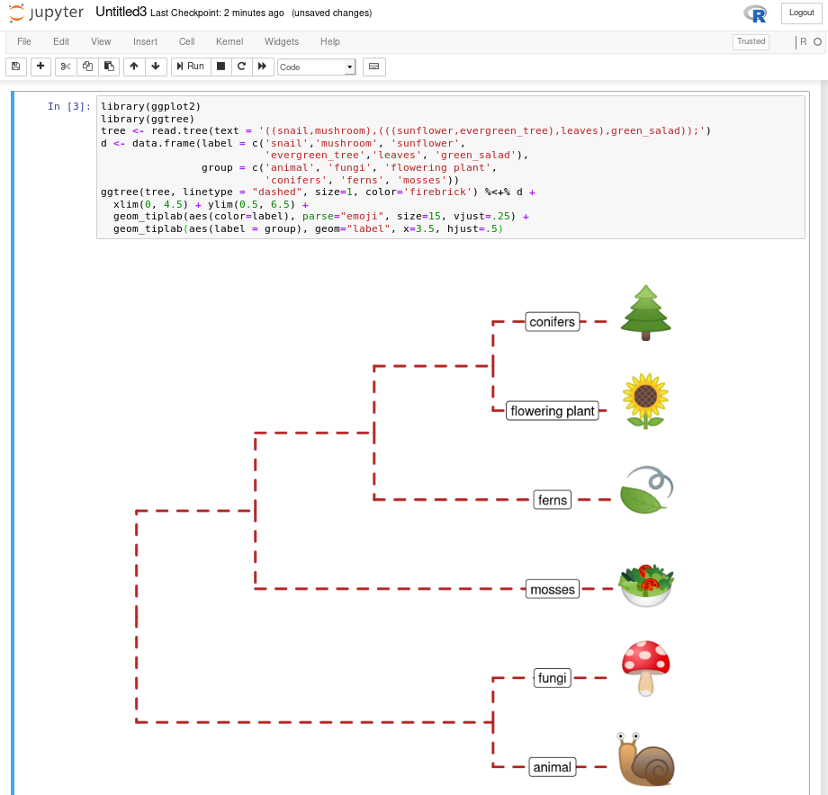

# B. 相关工具

**B.1 MicrobiotaProcess：将分类学表格转换为 treedata 对象**

分类学数据（如属、科等）在微生物组学或生态学中被广泛使用。层级分类学（Hierarchical taxonomies）是一种将事物组织为子类别的树状结构，它可以被转换为树对象（tree object，另见 phylo 对象）。`MicrobiotaProcess` 包支持将由 `phyloseq` 包定义的 `taxonomyTable` 对象转换为 `treedata` 对象，并且这种分类学的层级关系可以使用 `ggtree` 进行可视化（图 B.1）。当存在混乱或缺失的分类学名称时，针对 `taxonomyTable` 对象的 `as.treedata()` 方法会自动补全其上层分类学信息。

```R
library(MicrobiotaProcess)
library(ggtree)

# The original kostic2012crc is a MPSE object
data(kostic2012crc)

taxa <- tax_table(kostic2012crc)
#The rownames (usually is OTUs or other features ) of the taxa will be 
# served as the tip labels if include.rownames = TRUE
tree <- as.treedata(taxa, include.rownames=TRUE)
# Or extract the taxa tree (treedata) with mp_extract_tree, because the 
# taxonomy information is stored as treedata in the MPSE class (kostic2012crc).
# tree <- kostic2012crc %>% mp_extract_tree()

ggtree(tree, layout="circular", size=0.2) +
     geom_tiplab(size=1)
```



> 这段图注的中文翻译如下：
>
> **图 B.1：将 taxonomyTable 对象转换为 treedata 对象。**


**B.2 rtol：Open Tree API 的 R 语言接口**

`rtol` (Michonneau et al., 2016) 是一个用于与“生命开放树”（Open Tree of Life）数据 API 进行交互的 R 语言包。用户可以使用它来查询系统发育树，并结合 `ggtree` 对树进行可视化，从而探索物种之间的亲缘关系（图 B.2）。

```r
## example from: https://github.com/ropensci/rotl
library(rotl)
apes <- c("Pongo", "Pan", "Gorilla", "Hoolock", "Homo")
(resolved_names <- tnrs_match_names(apes))
```

```
## example from: https://github.com/ropensci/rotl
library(rotl)
apes <- c("Pongo", "Pan", "Gorilla", "Hoolock", "Homo")
(resolved_names <- tnrs_match_names(apes))
```

```R
tr <- tol_induced_subtree(ott_ids = ott_id(resolved_names))
ggtree(tr) + geom_tiplab() + xlim(NA, 5)
```



> **图 B.2：从庞大的 Open Tree（生命开放树）中提取诱导子树。**


## B.3 将 ggtree 对象转换为 plotly 对象

构建快速交互式系统发育树的一种方法是联合使用 `ggtree` 和 `plotly`。`ggplotly()` 函数能将 `ggtree` 对象转换为 `plotly` 对象。此外，`ggtree` 还支持通过 `identify()` 实现系统发育树交互式操作。

```R
# example from https://twitter.com/drandersgs/status/965996335882059776

# LOAD LIBS ---------------------------------------------------------------
library(ape)
library(ggtree)
library(plotly)
# CREATE A TREE -------------------------------------------------------------
n_samples <- 20
n_grp <- 4
tree <- ape::rtree(n = n_samples)
# CREATE SOME METADATA ----------------------------------------------------
id <- tree$tip.label
set.seed(42)
grp <- sample(LETTERS[1:n_grp], size = n_samples, replace = T)
dat <- tibble::tibble(id = id,
                      grp = grp)
# PLOT THE TREE -----------------------------------------------------------
p1 <- ggtree(tree)
metat <- p1$data %>%
  dplyr::inner_join(dat, c('label' = 'id'))
p2 <- p1 +
  geom_point(data = metat,
             aes(x = x,
                 y = y,
                 colour = grp,
                 label = id))
plotly::ggplotly(p2)
```


> 图 B.3：结合 `ggtree` 与 `plotly` 生成的交互式系统发育树。

**B.4 漫画风格（类似 xkcd）的系统发育树**

```R
library(htmltools)    
library(XML)    
library(gridSVG)    
library(ggplot2)    
library(ggtree)
library(comicR)    

p <- ggtree(rtree(30), layout="circular")  +
    geom_tiplab(aes(label=label), color="purple")
print(p)
svg <- grid.export(name="", res=100)$svg
```

```R
## need to convert it to png or pdf for pdfbook
tagList(
    tags$div(
             id = "ggtree_comic",
             tags$style("#ggtree_comic text {font-family:Comic Sans MS;}"),
             HTML(saveXML(svg)),
             comicR("#ggtree_comic", ff=5)
         )
) # %>% html_print
```



## B.5 Print ASCII-art Rooted Tree

```R
library(data.tree)
tree <- rtree(10)
d <- as.data.frame(as.Node(tree))
names(d) <- NULL
print(d, row.names=FALSE)
```

```
 11                    
  ¦--12                
  ¦   ¦--13            
  ¦   ¦   ¦--t4        
  ¦   ¦   °--t7        
  ¦   °--14            
  ¦       ¦--15        
  ¦       ¦   ¦--t1    
  ¦       ¦   °--16    
  ¦       ¦       ¦--t6
  ¦       ¦       °--t5
  ¦       °--t8        
  °--17                
      ¦--t3            
      °--18            
          ¦--19        
          ¦   ¦--t10   
          ¦   °--t9    
          °--t2     
```

将系统发育树以 ASCII 字符图的形式打印出来非常实用。有时候，我们并不想真正绘制出这棵树，而是希望在不离开 R 控制台（R console）焦点的情况下，快速浏览一下树的结构。然而，如果树非常庞大，将其全部以 ASCII 文本打印出来并不是个好主意。有时，我们只想查看树的某个特定部分及其直接相关的节点。在这种场景下，我们可以使用 `treeio::tree_subset()` 函数（参见第 2.4 节）来提取树的选定部分。然后，我们就可以在 R 控制台中打印出这部分子树的 ASCII 字符图，从而探索我们感兴趣的物种之间的演化关系。

此外，`ggtree` 支持将末端标签（tip labels）解析为 Emoji 表情符号，从而创建“表情符号系统发育树”（phylomoji）。借助 `data.tree` 和 `emojifont` 这两个包，我们还可以将这种表情符号系统发育树以 ASCII 文本的形式打印出来（图 B.4）。

```R
library(data.tree)
library(emojifont)

tt <- '((snail,mushroom),(((sunflower,evergreen_tree),leaves),green_salad));'
tree <- read.tree(text = tt)
tree$tip.label <- emoji(tree$tip.label)
d <- as.data.frame(as.Node(tree))
names(d) <- NULL
print(d, row.names=FALSE)
```



> **图 B.4：将表情符号系统发育树（phylomoji）以 ASCII 文本形式打印。**

另一种打印系统发育树 ASCII 字符图的方法，是使用 `devout` 包中定义的 `ascii()` 图形设备。下面是一个示例：

```R
library(devout)
ascii(width=80)
ggtree(rtree(5))
invisible(dev.off())
```

```
                                                                                
                             #########################                          
                             #                                                  
                            ##                                                  
                            ##                                                  
                            #####################                               
   ##########################                                                   
   #                        #                                                   
   #                        #                                                   
   #                        ##########                                          
   #                                                                            
   #                                                                            
   #                                                                            
   #                                   ###############                          
   #                                   #                                        
   #####################################                                        
                                       #                                        
                                       #####################################    
                                                                                
                                                                                 
```

**B.6 放大选定的分支区域**

除了使用 `viewClade()` 函数外，用户还可以使用 `ggforce` 包来放大查看选定的进化枝（clade）（图 B.5）。

```R
set.seed(2019-08-05)
x <- rtree(30)
nn <- tidytree::offspring(x, 43, self_include=TRUE)
ggtree(x) + ggforce::facet_zoom(xy = node %in% nn)
```



> **图 B.5：放大查看选定的进化枝。**

**B.7 结合 ggtree 与 ggimage 的使用技巧**

`ggtree` 支持通过 `ggimage` 包使用剪影图像（silhouette images）对系统发育树进行注释。`ggimage` 提供了用于处理图像文件的图形语法（grammar of graphic syntax）。它允许通过 `image_fun` 参数在绘图时即时处理图像，该参数接受一个用于处理 `magick-image` 对象的函数（图 B.6）。`magick` 包提供了多种图像处理函数，这些函数可以组合起来以执行特定的任务。

**B.7.1 示例 1：去除图像背景**

```R
library(ggimage)

imgdir <- system.file("extdata/frogs", package = "TDbook")

set.seed(1982)
x <- rtree(5)
p <- ggtree(x) + theme_grey()
p1 <- p + geom_nodelab(image=paste0(imgdir, "/frog.jpg"), 
                        geom="image", size=.12) + 
      ggtitle("original image")
p2 <- p + geom_nodelab(image=paste0(imgdir, "/frog.jpg"), 
            geom="image", size=.12,
            image_fun= function(.) magick::image_transparent(., "white")) + 
      ggtitle("image with background removed")
plot_grid(p1, p2, ncol=2)
```



> **图 B.6：去除图像背景。在系统发育树上绘制剪影图像：(A) 未去除背景；(B) 已去除背景。**

**B.7.2 示例 2：在背景图像上绘制系统发育树**

`geom_bgimage()` 函数会添加一个图像图层，并将其放置在图层堆栈的最底层。它是一个常规的图层，不会改变输出的 `ggtree` 对象的结构。因此，用户可以自由添加注释图层，而不受该背景图像图层的影响（图 B.7）。

```R
ggtree(rtree(20), size=1.5, color="white") + 
  geom_bgimage('img/blackboard.jpg') + 
  geom_tiplab(color="white", size=5, family='xkcd')
```



> **图 B.7：使用图像文件作为系统发育树的背景**

这段文本的中文翻译如下：

**B.8 在 Jupyter Notebook 中运行 ggtree**

如果你的系统上安装了 Jupyter Notebook，可以在 R 中运行以下命令来安装 IRkernel：

```r
install.packages("IRkernel")
IRkernel::installspec()
```

完成安装后，你就可以在 Jupyter Notebook 中使用 `ggtree` 及其他 R 语言包了（图 B.8）。下面是在 Jupyter Notebook 中重新绘制图 8.5 的截图。



> **图 B.8：在 Jupyter Notebook 中使用 ggtree。通过 R 内核（R kernel）在 Jupyter Notebook 中运行 ggtree。**